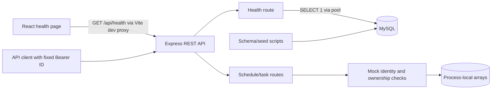
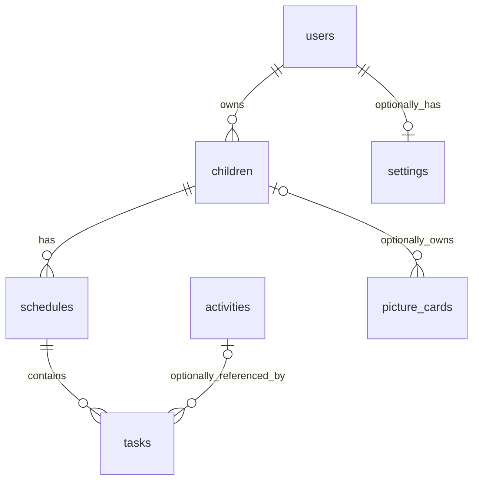

# Development Team Implementation Report

**Project:** Web-Based Visual Schedule, Task Management and Communication System for Children with Developmental Delays  
**Review date:** November 15, 2026  
**Baseline:** SRS v1.1 (November 14, 2026); local HEAD `d363a23f83906eee4d47112c15cd5809c8c28079` plus current working-tree files.  
**Audience:** Development, SRS and Research teams

The code provides an application foundation and mock-backed schedule/task APIs. It does not yet provide the complete Staff/Child system described in the SRS. This report traces every explicit ID to inspected evidence; it is neither a revised SRS nor a research paper.

## 1. Review method and coverage

- Extracted **114 distinct IDs** from the complete SRS: **96 behavioral requirement/use-case IDs** and **18 category labels ending in `-00`**. All appear below. Repeated references to an ID are counted once. Use cases are included explicitly, not silently omitted or counted as additional functional requirements.
- Read every application source file, SQL schema, schema/seed script, configuration/template, both route test files and existing project documentation. Searched implemented route mounts, storage, auth, SQL calls, browser state and speech APIs. File/line references are one-based and relative to the repository root; ranges identify actual inspected text. Links use repository line anchors.
- Each behavioral ID has a traceability row and a detailed evidence table. A related schema, fixture or backend helper is identified as a foundation when it does not implement the requested user behavior. “No matching implementation” is based on the complete router/UI boundaries and source inventory, not a failed name search alone.
- **Correctly Implemented:** the specific stated behavior is satisfied by available source/test evidence. This does not imply the whole application is complete. **Partially Implemented / Ongoing:** a matching portion/foundation exists but required behavior is incomplete; “ongoing” does not assert active developer work. **Implemented with Drift:** existing behavior demonstrably conflicts with the target. **Not Implemented:** no matching feature/operation exists. **Cannot Verify:** evidence cannot establish an empirical/process target; missing dependencies are still stated.
- Assessment follows the requirement's scope: an internal status model may be correct even when a separate UI or durability requirement fails. UI/workflow requirements are never marked correct merely because an API exists. Category labels are marked Cannot Verify because they contain no acceptance statement, and are excluded from behavioral completion counts.
- Unnumbered SRS interface/data rules and acceptance criteria are covered in supporting sections without inventing IDs. Priority/actor values below are copied from the SRS; an out-of-MVP Could feature remains in the inventory without being treated as a required MVP deliverable.

### Verification performed

| Check | Result and boundary |
| --- | --- |
| `npm.cmd run test -w @starter/api` | 2 test files passed; **39 passed, 1 todo**. Uses imported Express app and reset mock store; no live MySQL, real JWTs or browsers. |
| `npm.cmd run typecheck` | Passed for all three workspaces. |
| `npm.cmd run build` | Passed for shared package, API and web. Generated outputs are ignored build artifacts, not source changes. |
| Source/line validation | Every cited file/range was re-read and checked against the same source snapshot before finalizing; requirement coverage and summary counts were checked programmatically. |
| Not performed | No schema/seed execution or database mutation; no live MySQL/startup/health/restart test; no browser, load, accessibility or participant usability study. No external GitHub state was queried. |

The automated fixtures are explicit at [apps/api/src/routes/schedules.test.ts:1–19](../apps/api/src/routes/schedules.test.ts#L1-L19) and [apps/api/src/routes/tasks.test.ts:1–19](../apps/api/src/routes/tasks.test.ts#L1-L19). Restart persistence is only a todo at [apps/api/src/routes/tasks.test.ts:256–258](../apps/api/src/routes/tasks.test.ts#L256-L258). Passing tests cannot be presented as SRS acceptance or research findings.

## 2. Requirement traceability and detailed findings

Each group starts with a compact status index. Its per-ID tables contain the full SRS statement, exact locations/handlers, behavior, correctness/gaps and test evidence. For missing features, boundary citations show what is actually mounted/rendered; they are not claimed implementations of that feature.

### Authentication and account (FR-AUTH)

| ID | Requirement / use-case description | Implementation status |
| --- | --- | --- |
| [FR-AUTH-01](#fr-auth-01) | The system shall allow a Staff member to register with name, email, password and role (Caregiver, OT or SPED Teacher). | Not Implemented |
| [FR-AUTH-02](#fr-auth-02) | The system shall validate registration input (valid email format, minimum password length of 8 characters, required fields) and reject duplicate emails. | Partially Implemented / Ongoing |
| [FR-AUTH-03](#fr-auth-03) | The system shall store passwords only as salted hashes (e.g., bcrypt). | Not Implemented |
| [FR-AUTH-04](#fr-auth-04) | The system shall allow registered Staff to log in with email and password and receive a JWT. | Not Implemented |
| [FR-AUTH-05](#fr-auth-05) | The system shall protect all non-public API routes and pages so that only authenticated users can access them. | Implemented with Drift |
| [FR-AUTH-06](#fr-auth-06) | The system shall allow the user to log out, clearing the stored token. | Not Implemented |
| [FR-AUTH-07](#fr-auth-07) | The system shall handle an expired or invalid token by returning the user to the login page with a clear message. | Partially Implemented / Ongoing |
| [FR-AUTH-08](#fr-auth-08) | The system shall offer a "Remember me" option on login. | Not Implemented |

#### FR-AUTH-01

| Traceability field | Finding |
| --- | --- |
| SRS requires | The system shall allow a Staff member to register with name, email, password and role (Caregiver, OT or SPED Teacher). ([docs/SRS.md:170–170](SRS.md#L170-L170); priority: Must) |
| Implementation status | **Not Implemented** |
| Exact source location and handler | No registration endpoint/component. [apps/api/src/app.ts:17–23](../apps/api/src/app.ts#L17-L23) (complete router mounts/404 fallback); [apps/web/src/App.tsx:4–25](../apps/web/src/App.tsx#L4-L25) (complete current UI); [apps/api/schema.sql:1–10](../apps/api/schema.sql#L1-L10) (users table only) |
| Current implementation | Only fixed mock users and a SQL demo account exist; users cannot submit registration. |
| Satisfies SRS / drift / remaining work | No. Implement registration, account insertion and its form; recording roles in an enum is not registration. |
| Related tests | None found for this requirement. The existing suite only exercises mock schedule/task routes. |

#### FR-AUTH-02

| Traceability field | Finding |
| --- | --- |
| SRS requires | The system shall validate registration input (valid email format, minimum password length of 8 characters, required fields) and reject duplicate emails. ([docs/SRS.md:171–171](SRS.md#L171-L171); priority: Must) |
| Implementation status | **Partially Implemented / Ongoing** |
| Exact source location and handler | [apps/api/schema.sql:1–10](../apps/api/schema.sql#L1-L10) — uq_users_email; [packages/shared/src/schemas.ts:3–7](../packages/shared/src/schemas.ts#L3-L7) — role enum only; [apps/api/src/app.ts:17–23](../apps/api/src/app.ts#L17-L23) (complete router mounts/404 fallback); [apps/web/src/App.tsx:4–25](../apps/web/src/App.tsx#L4-L25) (complete current UI) |
| Current implementation | The SQL definition enforces unique email, but there is no registration input schema or handler. |
| Satisfies SRS / drift / remaining work | Only duplicate prevention at schema level is present. Email syntax, password length, required-field checks and duplicate API responses are absent; live constraint execution was not tested. |
| Related tests | None found for this requirement. The existing suite only exercises mock schedule/task routes. |

#### FR-AUTH-03

| Traceability field | Finding |
| --- | --- |
| SRS requires | The system shall store passwords only as salted hashes (e.g., bcrypt). ([docs/SRS.md:172–172](SRS.md#L172-L172); priority: Must) |
| Implementation status | **Not Implemented** |
| Exact source location and handler | No matching implementation or handler. Inspected boundaries: [apps/api/src/app.ts:17–23](../apps/api/src/app.ts#L17-L23) (complete router mounts/404 fallback); [apps/web/src/App.tsx:4–25](../apps/web/src/App.tsx#L4-L25) (complete current UI). Related foundation only: [apps/api/schema.sql:1–10](../apps/api/schema.sql#L1-L10) — nullable password_hash; [apps/api/scripts/seed.ts:118–128](../apps/api/scripts/seed.ts#L118-L128) — seedData inserts a NULL hash, not a hashed login account. |
| Current implementation | No password hashing or password-writing registration flow exists |
| Satisfies SRS / drift / remaining work | Does not satisfy the requirement. No password hashing or password-writing registration flow exists |
| Related tests | None found for this requirement. The existing suite only exercises mock schedule/task routes. |

#### FR-AUTH-04

| Traceability field | Finding |
| --- | --- |
| SRS requires | The system shall allow registered Staff to log in with email and password and receive a JWT. ([docs/SRS.md:173–173](SRS.md#L173-L173); priority: Must) |
| Implementation status | **Not Implemented** |
| Exact source location and handler | No matching implementation or handler. Inspected boundaries: [apps/api/src/app.ts:17–23](../apps/api/src/app.ts#L17-L23) (complete router mounts/404 fallback); [apps/web/src/App.tsx:4–25](../apps/web/src/App.tsx#L4-L25) (complete current UI). Related foundation only: [apps/api/src/mocks/auth.ts:19–35](../apps/api/src/mocks/auth.ts#L19-L35) — only Bearer IDs 1 and 2. |
| Current implementation | No email/password login or JWT issuance exists |
| Satisfies SRS / drift / remaining work | Does not satisfy the requirement. No email/password login or JWT issuance exists |
| Related tests | None found for this requirement. The existing suite only exercises mock schedule/task routes. |

#### FR-AUTH-05

| Traceability field | Finding |
| --- | --- |
| SRS requires | The system shall protect all non-public API routes and pages so that only authenticated users can access them. ([docs/SRS.md:174–174](SRS.md#L174-L174); priority: Must) |
| Implementation status | **Implemented with Drift** |
| Exact source location and handler | [apps/api/src/mocks/auth.ts:19–42](../apps/api/src/mocks/auth.ts#L19-L42) — requireAuth/currentUser; [apps/api/src/routes/schedules.ts:13–14](../apps/api/src/routes/schedules.ts#L13-L14); [apps/api/src/routes/tasks.ts:13–14](../apps/api/src/routes/tasks.ts#L13-L14); [apps/web/src/App.tsx:4–25](../apps/web/src/App.tsx#L4-L25) |
| Current implementation | Feature routers invoke middleware, which selects a fixed user by the literal Bearer token. Anyone knowing 1 or 2 can assume that identity; the frontend has no protected pages. |
| Satisfies SRS / drift / remaining work | No. This substitutes an ID lookup for authenticated access. Replace it with signed-token verification and protect actual product pages; health remains public. |
| Related tests | [apps/api/src/routes/schedules.test.ts:21–35](../apps/api/src/routes/schedules.test.ts#L21-L35) — missing/unknown mock token rejected; [apps/api/src/routes/tasks.test.ts:81–84](../apps/api/src/routes/tasks.test.ts#L81-L84) — task creation without a token rejected; these tests do not establish real identity. |

#### FR-AUTH-06

| Traceability field | Finding |
| --- | --- |
| SRS requires | The system shall allow the user to log out, clearing the stored token. ([docs/SRS.md:175–175](SRS.md#L175-L175); priority: Must) |
| Implementation status | **Not Implemented** |
| Exact source location and handler | No matching implementation or handler. Inspected boundaries: [apps/api/src/app.ts:17–23](../apps/api/src/app.ts#L17-L23) (complete router mounts/404 fallback); [apps/web/src/App.tsx:4–25](../apps/web/src/App.tsx#L4-L25) (complete current UI). |
| Current implementation | No logout control, token storage or token-clearing function exists |
| Satisfies SRS / drift / remaining work | Does not satisfy the requirement. No logout control, token storage or token-clearing function exists |
| Related tests | None found for this requirement. The existing suite only exercises mock schedule/task routes. |

#### FR-AUTH-07

| Traceability field | Finding |
| --- | --- |
| SRS requires | The system shall handle an expired or invalid token by returning the user to the login page with a clear message. ([docs/SRS.md:176–176](SRS.md#L176-L176); priority: Should) |
| Implementation status | **Partially Implemented / Ongoing** |
| Exact source location and handler | [apps/api/src/mocks/auth.ts:24–35](../apps/api/src/mocks/auth.ts#L24-L35) — 401 rejection; [apps/web/src/App.tsx:6–14](../apps/web/src/App.tsx#L6-L14) — health catch only |
| Current implementation | Unknown IDs get a 401 message containing “Invalid or expired token”; fixed mock tokens never expire. |
| Satisfies SRS / drift / remaining work | Partial error handling only. No expiry validation, login page, redirect or session-expiry message in the UI. |
| Related tests | [apps/api/src/routes/schedules.test.ts:28–35](../apps/api/src/routes/schedules.test.ts#L28-L35) — unknown token returns 401; no expiry/redirect test |

#### FR-AUTH-08

| Traceability field | Finding |
| --- | --- |
| SRS requires | The system shall offer a "Remember me" option on login. ([docs/SRS.md:177–177](SRS.md#L177-L177); priority: Could) |
| Implementation status | **Not Implemented** |
| Exact source location and handler | No matching implementation or handler. Inspected boundaries: [apps/api/src/app.ts:17–23](../apps/api/src/app.ts#L17-L23) (complete router mounts/404 fallback); [apps/web/src/App.tsx:4–25](../apps/web/src/App.tsx#L4-L25) (complete current UI). |
| Current implementation | No login form or Remember me option exists |
| Satisfies SRS / drift / remaining work | Does not satisfy the requirement. No login form or Remember me option exists |
| Related tests | None found for this requirement. The existing suite only exercises mock schedule/task routes. |

### Child profiles (FR-CHILD)

| ID | Requirement / use-case description | Implementation status |
| --- | --- | --- |
| [FR-CHILD-01](#fr-child-01) | The system shall allow Staff to create a child profile with name (or nickname), age, delay domain (e.g., speech, motor, cognitive, social, general) and optional notes. | Partially Implemented / Ongoing |
| [FR-CHILD-02](#fr-child-02) | The system shall allow Staff to view a list of their child profiles on the dashboard. | Not Implemented |
| [FR-CHILD-03](#fr-child-03) | The system shall allow Staff to edit a child profile. | Not Implemented |
| [FR-CHILD-04](#fr-child-04) | The system shall allow Staff to delete a child profile after confirmation; related schedules and tasks shall be deleted with it. | Partially Implemented / Ongoing |
| [FR-CHILD-05](#fr-child-05) | The system shall let a child profile use a predefined avatar (icon/emoji) instead of a photo. | Partially Implemented / Ongoing |
| [FR-CHILD-06](#fr-child-06) | The system shall restrict each Staff member to the child profiles they created (data isolation). | Partially Implemented / Ongoing |

#### FR-CHILD-01

| Traceability field | Finding |
| --- | --- |
| SRS requires | The system shall allow Staff to create a child profile with name (or nickname), age, delay domain (e.g., speech, motor, cognitive, social, general) and optional notes. ([docs/SRS.md:183–183](SRS.md#L183-L183); priority: Must) |
| Implementation status | **Partially Implemented / Ongoing** |
| Exact source location and handler | [apps/api/schema.sql:12–26](../apps/api/schema.sql#L12-L26) — children; [apps/api/scripts/seed.ts:130–151](../apps/api/scripts/seed.ts#L130-L151) — seedData; [apps/api/src/mocks/data.ts:69–81](../apps/api/src/mocks/data.ts#L69-L81) — seed; [apps/api/src/app.ts:17–23](../apps/api/src/app.ts#L17-L23) (complete router mounts/404 fallback); [apps/web/src/App.tsx:4–25](../apps/web/src/App.tsx#L4-L25) (complete current UI) |
| Current implementation | Schema fields and demo insertion cover name, age, delay domain and notes storage. API children are fixed fixtures. |
| Satisfies SRS / drift / remaining work | Foundation only; no matching Staff create handler, input schema or form. Add authenticated child creation with validation and persistence. |
| Related tests | None found for this requirement. The existing suite only exercises mock schedule/task routes. |

#### FR-CHILD-02

| Traceability field | Finding |
| --- | --- |
| SRS requires | The system shall allow Staff to view a list of their child profiles on the dashboard. ([docs/SRS.md:184–184](SRS.md#L184-L184); priority: Must) |
| Implementation status | **Not Implemented** |
| Exact source location and handler | No matching implementation or handler. Inspected boundaries: [apps/api/src/app.ts:17–23](../apps/api/src/app.ts#L17-L23) (complete router mounts/404 fallback); [apps/web/src/App.tsx:4–25](../apps/web/src/App.tsx#L4-L25) (complete current UI). Related foundation only: [apps/api/src/mocks/data.ts:89–91](../apps/api/src/mocks/data.ts#L89-L91) — findChildForUser returns a single fixture, not a dashboard list. |
| Current implementation | No child-list endpoint or dashboard component exists |
| Satisfies SRS / drift / remaining work | Does not satisfy the requirement. No child-list endpoint or dashboard component exists |
| Related tests | None found for this requirement. The existing suite only exercises mock schedule/task routes. |

#### FR-CHILD-03

| Traceability field | Finding |
| --- | --- |
| SRS requires | The system shall allow Staff to edit a child profile. ([docs/SRS.md:185–185](SRS.md#L185-L185); priority: Must) |
| Implementation status | **Not Implemented** |
| Exact source location and handler | No matching implementation or handler. Inspected boundaries: [apps/api/src/app.ts:17–23](../apps/api/src/app.ts#L17-L23) (complete router mounts/404 fallback); [apps/web/src/App.tsx:4–25](../apps/web/src/App.tsx#L4-L25) (complete current UI). Related foundation only: [apps/api/schema.sql:12–26](../apps/api/schema.sql#L12-L26). |
| Current implementation | No child update function, API route or editing form exists |
| Satisfies SRS / drift / remaining work | Does not satisfy the requirement. No child update function, API route or editing form exists |
| Related tests | None found for this requirement. The existing suite only exercises mock schedule/task routes. |

#### FR-CHILD-04

| Traceability field | Finding |
| --- | --- |
| SRS requires | The system shall allow Staff to delete a child profile after confirmation; related schedules and tasks shall be deleted with it. ([docs/SRS.md:186–186](SRS.md#L186-L186); priority: Must) |
| Implementation status | **Partially Implemented / Ongoing** |
| Exact source location and handler | [apps/api/schema.sql:37–47](../apps/api/schema.sql#L37-L47); [apps/api/schema.sql:49–69](../apps/api/schema.sql#L49-L69) — child→schedule→task cascade definitions; [apps/api/schema.sql:71–83](../apps/api/schema.sql#L71-L83) — custom-card cascade; [apps/api/src/app.ts:17–23](../apps/api/src/app.ts#L17-L23) (complete router mounts/404 fallback); [apps/web/src/App.tsx:4–25](../apps/web/src/App.tsx#L4-L25) (complete current UI) |
| Current implementation | Foreign keys describe deletion cascades, but neither application store exposes child deletion. |
| Satisfies SRS / drift / remaining work | Partial data design only. There is no DELETE child handler or confirmation UI, and SQL cascades have not been exercised. |
| Related tests | [apps/api/src/routes/schedules.test.ts:228–246](../apps/api/src/routes/schedules.test.ts#L228-L246) — schedule deletion removes its mock tasks; this is not child deletion |

#### FR-CHILD-05

| Traceability field | Finding |
| --- | --- |
| SRS requires | The system shall let a child profile use a predefined avatar (icon/emoji) instead of a photo. ([docs/SRS.md:187–187](SRS.md#L187-L187); priority: Should) |
| Implementation status | **Partially Implemented / Ongoing** |
| Exact source location and handler | [apps/api/schema.sql:12–26](../apps/api/schema.sql#L12-L26) — children.avatar; [apps/api/src/mocks/data.ts:69–81](../apps/api/src/mocks/data.ts#L69-L81) — seed; [apps/api/scripts/seed.ts:32–72](../apps/api/scripts/seed.ts#L32-L72) — demoChildren |
| Current implementation | Profiles have predefined emoji avatar values/defaults in SQL and fixtures. |
| Satisfies SRS / drift / remaining work | Partial. Avatar storage is present; Staff cannot choose or update an avatar and no profile UI renders it. |
| Related tests | None found for this requirement. The existing suite only exercises mock schedule/task routes. |

#### FR-CHILD-06

| Traceability field | Finding |
| --- | --- |
| SRS requires | The system shall restrict each Staff member to the child profiles they created (data isolation). ([docs/SRS.md:188–188](SRS.md#L188-L188); priority: Must) |
| Implementation status | **Partially Implemented / Ongoing** |
| Exact source location and handler | [apps/api/src/mocks/data.ts:89–91](../apps/api/src/mocks/data.ts#L89-L91) — findChildForUser; [apps/api/src/mocks/data.ts:105–109](../apps/api/src/mocks/data.ts#L105-L109) — findScheduleForUser; [apps/api/src/mocks/data.ts:171–175](../apps/api/src/mocks/data.ts#L171-L175) — findTaskForUser; [apps/api/src/routes/schedules.ts:28–41](../apps/api/src/routes/schedules.ts#L28-L41); [apps/api/src/mocks/auth.ts:19–35](../apps/api/src/mocks/auth.ts#L19-L35) |
| Current implementation | Existing feature requests check the mock child owner and return 404 for another fixed identity. |
| Satisfies SRS / drift / remaining work | Partial. Child CRUD/listing and real identity checks are absent. Spoofable Bearer IDs cannot establish Staff isolation. |
| Related tests | [apps/api/src/routes/schedules.test.ts:58–64](../apps/api/src/routes/schedules.test.ts#L58-L64) — create against another owner’s child rejected; [apps/api/src/routes/schedules.test.ts:157–164](../apps/api/src/routes/schedules.test.ts#L157-L164) — read against another owner’s child rejected |

### Visual schedules (FR-SCH)

| ID | Requirement / use-case description | Implementation status |
| --- | --- | --- |
| [FR-SCH-01](#fr-sch-01) | The system shall provide a predefined activity library (e.g., wake up, brush teeth, wash hands, eat breakfast, get dressed, toilet, go to school, learning activity, play, bath, get ready for bed), each with an icon and category (hygiene, food, school, play, other). | Partially Implemented / Ongoing |
| [FR-SCH-02](#fr-sch-02) | The system shall let Staff create a schedule for a selected child for a selected date by adding activities from the library. | Partially Implemented / Ongoing |
| [FR-SCH-03](#fr-sch-03) | The system shall let Staff add activities by drag-and-drop and by an "Add" button, so the feature still works on touch devices. | Not Implemented |
| [FR-SCH-04](#fr-sch-04) | The system shall let Staff reorder activities within a schedule. | Partially Implemented / Ongoing |
| [FR-SCH-05](#fr-sch-05) | The system shall let Staff set, per activity, an optional start time and a duration in minutes. | Partially Implemented / Ongoing |
| [FR-SCH-06](#fr-sch-06) | The system shall let Staff remove an activity from a schedule. | Partially Implemented / Ongoing |
| [FR-SCH-07](#fr-sch-07) | The system shall show activities color-coded by category. | Not Implemented |
| [FR-SCH-08](#fr-sch-08) | The system shall let Staff create a custom text activity (name plus a chosen icon from a predefined set). | Partially Implemented / Ongoing |
| [FR-SCH-09](#fr-sch-09) | The system shall let Staff copy a schedule from another date (e.g., previous day) to a new date. | Partially Implemented / Ongoing |
| [FR-SCH-10](#fr-sch-10) | The system shall provide a preview of the schedule as the child will see it. | Not Implemented |

#### FR-SCH-01

| Traceability field | Finding |
| --- | --- |
| SRS requires | The system shall provide a predefined activity library (e.g., wake up, brush teeth, wash hands, eat breakfast, get dressed, toilet, go to school, learning activity, play, bath, get ready for bed), each with an icon and category (hygiene, food, school, play, other). ([docs/SRS.md:194–194](SRS.md#L194-L194); priority: Must) |
| Implementation status | **Partially Implemented / Ongoing** |
| Exact source location and handler | [apps/api/src/mocks/data.ts:46–59](../apps/api/src/mocks/data.ts#L46-L59) — ACTIVITIES; [apps/api/src/mocks/data.ts:93–99](../apps/api/src/mocks/data.ts#L93-L99) — listActivities/findActivity; [apps/api/scripts/seed.ts:5–17](../apps/api/scripts/seed.ts#L5-L17) — activities; [apps/api/src/routes/tasks.ts:24–55](../apps/api/src/routes/tasks.ts#L24-L55) — POST /api/tasks |
| Current implementation | A 12-entry mock library supplies names/icons/categories; SQL seed defines 11 activities. Task creation resolves activity IDs internally. |
| Satisfies SRS / drift / remaining work | Partial. listActivities is not mounted as an endpoint, and no library UI exists. Reconcile SQL/mock icons and IDs; the extra mock Eat lunch is not itself contrary to the SRS examples. |
| Related tests | [apps/api/src/routes/tasks.test.ts:26–40](../apps/api/src/routes/tasks.test.ts#L26-L40) — library task receives the selected name/icon; category/library listing is not tested |

#### FR-SCH-02

| Traceability field | Finding |
| --- | --- |
| SRS requires | The system shall let Staff create a schedule for a selected child for a selected date by adding activities from the library. ([docs/SRS.md:195–195](SRS.md#L195-L195); priority: Must) |
| Implementation status | **Partially Implemented / Ongoing** |
| Exact source location and handler | [apps/api/src/routes/schedules.ts:43–66](../apps/api/src/routes/schedules.ts#L43-L66) — POST /api/schedules; [apps/api/src/routes/tasks.ts:24–55](../apps/api/src/routes/tasks.ts#L24-L55) — POST /api/tasks; [apps/api/src/mocks/data.ts:115–124](../apps/api/src/mocks/data.ts#L115-L124) — createSchedule; [apps/api/src/mocks/data.ts:139–157](../apps/api/src/mocks/data.ts#L139-L157) — addTask |
| Current implementation | Creates an owned child/date schedule, rejects duplicates, then accepts library tasks through a separate call. |
| Satisfies SRS / drift / remaining work | Partial. This works for fixture children through an API client only; no Staff selection/creator UI, real auth or SQL writes. |
| Related tests | [apps/api/src/routes/schedules.test.ts:38–56](../apps/api/src/routes/schedules.test.ts#L38-L56) — create/duplicate/different child; [apps/api/src/routes/tasks.test.ts:26–40](../apps/api/src/routes/tasks.test.ts#L26-L40) — add library task |

#### FR-SCH-03

| Traceability field | Finding |
| --- | --- |
| SRS requires | The system shall let Staff add activities by drag-and-drop and by an "Add" button, so the feature still works on touch devices. ([docs/SRS.md:196–196](SRS.md#L196-L196); priority: Must) |
| Implementation status | **Not Implemented** |
| Exact source location and handler | No matching implementation or handler. Inspected boundaries: [apps/api/src/app.ts:17–23](../apps/api/src/app.ts#L17-L23) (complete router mounts/404 fallback); [apps/web/src/App.tsx:4–25](../apps/web/src/App.tsx#L4-L25) (complete current UI). Related foundation only: [apps/api/src/routes/tasks.ts:24–55](../apps/api/src/routes/tasks.ts#L24-L55) — API add operation only. |
| Current implementation | No drag-and-drop handlers or Add button exist |
| Satisfies SRS / drift / remaining work | Does not satisfy the requirement. No drag-and-drop handlers or Add button exist |
| Related tests | [apps/api/src/routes/tasks.test.ts:26–40](../apps/api/src/routes/tasks.test.ts#L26-L40) — API addition does not test touch controls |

#### FR-SCH-04

| Traceability field | Finding |
| --- | --- |
| SRS requires | The system shall let Staff reorder activities within a schedule. ([docs/SRS.md:197–197](SRS.md#L197-L197); priority: Must) |
| Implementation status | **Partially Implemented / Ongoing** |
| Exact source location and handler | [apps/api/src/routes/tasks.ts:57–72](../apps/api/src/routes/tasks.ts#L57-L72) — PUT /api/tasks/:id; [apps/api/src/mocks/data.ts:183–197](../apps/api/src/mocks/data.ts#L183-L197) — applyTaskUpdate; [packages/shared/src/schemas.ts:58–68](../packages/shared/src/schemas.ts#L58-L68) — updateTaskSchema |
| Current implementation | Moving a one-based position shifts neighboring tasks and keeps positions consecutive; positions beyond task count are rejected. |
| Satisfies SRS / drift / remaining work | Partial. Tested in memory; no Staff reorder controls or persistent/concurrent SQL ordering. |
| Related tests | [apps/api/src/routes/tasks.test.ts:104–123](../apps/api/src/routes/tasks.test.ts#L104-L123) — reorders/resequences; [apps/api/src/routes/tasks.test.ts:125–141](../apps/api/src/routes/tasks.test.ts#L125-L141) — invalid updates |

#### FR-SCH-05

| Traceability field | Finding |
| --- | --- |
| SRS requires | The system shall let Staff set, per activity, an optional start time and a duration in minutes. ([docs/SRS.md:198–198](SRS.md#L198-L198); priority: Must) |
| Implementation status | **Partially Implemented / Ongoing** |
| Exact source location and handler | [apps/api/src/routes/tasks.ts:57–72](../apps/api/src/routes/tasks.ts#L57-L72) — PUT /api/tasks/:id; [apps/api/src/mocks/data.ts:183–197](../apps/api/src/mocks/data.ts#L183-L197) — applyTaskUpdate; [packages/shared/src/schemas.ts:17–19](../packages/shared/src/schemas.ts#L17-L19); [packages/shared/src/schemas.ts:58–68](../packages/shared/src/schemas.ts#L58-L68) — HH:MM and duration validation |
| Current implementation | Accepts HH:MM start time and 1–1440 minute duration, both nullable to clear; omitted fields stay unchanged. |
| Satisfies SRS / drift / remaining work | Partial. API timing works in memory but Staff timing inputs and SQL persistence are absent. |
| Related tests | [apps/api/src/routes/tasks.test.ts:88–102](../apps/api/src/routes/tasks.test.ts#L88-L102) — set/clear time and duration; [apps/api/src/routes/tasks.test.ts:125–141](../apps/api/src/routes/tasks.test.ts#L125-L141) — invalid timing/order inputs |

#### FR-SCH-06

| Traceability field | Finding |
| --- | --- |
| SRS requires | The system shall let Staff remove an activity from a schedule. ([docs/SRS.md:199–199](SRS.md#L199-L199); priority: Must) |
| Implementation status | **Partially Implemented / Ongoing** |
| Exact source location and handler | [apps/api/src/routes/tasks.ts:74–82](../apps/api/src/routes/tasks.ts#L74-L82) — DELETE /api/tasks/:id; [apps/api/src/mocks/data.ts:177–181](../apps/api/src/mocks/data.ts#L177-L181) — resequence; [apps/api/src/mocks/data.ts:199–202](../apps/api/src/mocks/data.ts#L199-L202) — removeTask |
| Current implementation | Removes an owned task and resequences remaining positions. |
| Satisfies SRS / drift / remaining work | Partial. No Staff remove control or SQL delete; durability and transaction handling remain. |
| Related tests | [apps/api/src/routes/tasks.test.ts:199–220](../apps/api/src/routes/tasks.test.ts#L199-L220) — remove/resequence and other-user rejection |

#### FR-SCH-07

| Traceability field | Finding |
| --- | --- |
| SRS requires | The system shall show activities color-coded by category. ([docs/SRS.md:200–200](SRS.md#L200-L200); priority: Should) |
| Implementation status | **Not Implemented** |
| Exact source location and handler | No matching implementation or handler. Inspected boundaries: [apps/api/src/app.ts:17–23](../apps/api/src/app.ts#L17-L23) (complete router mounts/404 fallback); [apps/web/src/App.tsx:4–25](../apps/web/src/App.tsx#L4-L25) (complete current UI). Related foundation only: [apps/api/src/mocks/data.ts:14–19](../apps/api/src/mocks/data.ts#L14-L19) — Activity.category; [apps/api/src/mocks/data.ts:28–39](../apps/api/src/mocks/data.ts#L28-L39) — Task has no category; [apps/web/src/styles.css:1–10](../apps/web/src/styles.css#L1-L10) — starter styling only. |
| Current implementation | No category color mapping or schedule rendering exists |
| Satisfies SRS / drift / remaining work | Does not satisfy the requirement. No category color mapping or schedule rendering exists |
| Related tests | None found for this requirement. The existing suite only exercises mock schedule/task routes. |

#### FR-SCH-08

| Traceability field | Finding |
| --- | --- |
| SRS requires | The system shall let Staff create a custom text activity (name plus a chosen icon from a predefined set). ([docs/SRS.md:201–201](SRS.md#L201-L201); priority: Should) |
| Implementation status | **Partially Implemented / Ongoing** |
| Exact source location and handler | [apps/api/src/routes/tasks.ts:24–55](../apps/api/src/routes/tasks.ts#L24-L55) — POST /api/tasks; [packages/shared/src/schemas.ts:40–56](../packages/shared/src/schemas.ts#L40-L56) — createTaskSchema; [apps/api/src/mocks/data.ts:41–44](../apps/api/src/mocks/data.ts#L41-L44) — PREDEFINED_ICONS; [apps/api/src/mocks/data.ts:101–103](../apps/api/src/mocks/data.ts#L101-L103) — isPredefinedIcon |
| Current implementation | Requires either activityId or trimmed name plus allowlisted emoji; custom tasks have null activity_id. |
| Satisfies SRS / drift / remaining work | Partial. Validated API creation exists; no icon chooser/Staff form or SQL persistence. |
| Related tests | [apps/api/src/routes/tasks.test.ts:42–46](../apps/api/src/routes/tasks.test.ts#L42-L46) — valid custom task; [apps/api/src/routes/tasks.test.ts:55–69](../apps/api/src/routes/tasks.test.ts#L55-L69) — invalid/mixed/unsupported icon rejected |

#### FR-SCH-09

| Traceability field | Finding |
| --- | --- |
| SRS requires | The system shall let Staff copy a schedule from another date (e.g., previous day) to a new date. ([docs/SRS.md:202–202](SRS.md#L202-L202); priority: Should) |
| Implementation status | **Partially Implemented / Ongoing** |
| Exact source location and handler | [apps/api/src/routes/schedules.ts:43–66](../apps/api/src/routes/schedules.ts#L43-L66) — POST /api/schedules with copyFrom; [apps/api/src/mocks/data.ts:159–169](../apps/api/src/mocks/data.ts#L159-L169) — copyTasks |
| Current implementation | Copies the same child’s source-date tasks to new IDs, retaining content/order/timing and resetting status/completed_at. |
| Satisfies SRS / drift / remaining work | Partial. No Staff copy UI or persistent atomic SQL copy; backend behavior matches the requested copy semantics in memory. |
| Related tests | [apps/api/src/routes/schedules.test.ts:85–123](../apps/api/src/routes/schedules.test.ts#L85-L123) — copy content/timing/reset and missing-source failure |

#### FR-SCH-10

| Traceability field | Finding |
| --- | --- |
| SRS requires | The system shall provide a preview of the schedule as the child will see it. ([docs/SRS.md:203–203](SRS.md#L203-L203); priority: Should) |
| Implementation status | **Not Implemented** |
| Exact source location and handler | No matching implementation or handler. Inspected boundaries: [apps/api/src/app.ts:17–23](../apps/api/src/app.ts#L17-L23) (complete router mounts/404 fallback); [apps/web/src/App.tsx:4–25](../apps/web/src/App.tsx#L4-L25) (complete current UI). |
| Current implementation | No child-style schedule preview component or view exists |
| Satisfies SRS / drift / remaining work | Does not satisfy the requirement. No child-style schedule preview component or view exists |
| Related tests | None found for this requirement. The existing suite only exercises mock schedule/task routes. |

### Task management (FR-TASK)

| ID | Requirement / use-case description | Implementation status |
| --- | --- | --- |
| [FR-TASK-01](#fr-task-01) | The system shall treat each activity in a schedule as a task with a status of pending or done. | Correctly Implemented |
| [FR-TASK-02](#fr-task-02) | The system shall let a task be marked as done from the Child view and from the Staff view. | Partially Implemented / Ongoing |
| [FR-TASK-03](#fr-task-03) | The system shall record the completion time of each completed task. | Partially Implemented / Ongoing |
| [FR-TASK-04](#fr-task-04) | The system shall let Staff undo a completion (set the task back to pending). | Partially Implemented / Ongoing |
| [FR-TASK-05](#fr-task-05) | The system shall show Staff the list of tasks for a child and date with their status. | Partially Implemented / Ongoing |
| [FR-TASK-06](#fr-task-06) | The system shall provide an optional visual countdown timer (color-coded circle or pie) for tasks with a duration, with a gentle visual cue near the end. | Not Implemented |
| [FR-TASK-07](#fr-task-07) | The system shall provide an optional sound cue when a timer ends, which can be turned off. | Not Implemented |

#### FR-TASK-01

| Traceability field | Finding |
| --- | --- |
| SRS requires | The system shall treat each activity in a schedule as a task with a status of pending or done. ([docs/SRS.md:209–209](SRS.md#L209-L209); priority: Must) |
| Implementation status | **Correctly Implemented** |
| Exact source location and handler | [apps/api/src/mocks/data.ts:28–39](../apps/api/src/mocks/data.ts#L28-L39) — Task; [apps/api/src/mocks/data.ts:139–157](../apps/api/src/mocks/data.ts#L139-L157) — addTask; [apps/api/src/mocks/data.ts:204–214](../apps/api/src/mocks/data.ts#L204-L214) — setTaskCompletion; [apps/api/schema.sql:49–69](../apps/api/schema.sql#L49-L69) — tasks.status |
| Current implementation | Each added schedule activity is a Task initialized pending; boolean completion/undo changes it between pending and done. SQL defines the same enum. |
| Satisfies SRS / drift / remaining work | Yes, for the narrowly stated task/status model. This does not establish Staff/Child UI or persistence; those are assessed separately. |
| Related tests | [apps/api/src/routes/tasks.test.ts:26–40](../apps/api/src/routes/tasks.test.ts#L26-L40) — initial pending status; [apps/api/src/routes/tasks.test.ts:151–167](../apps/api/src/routes/tasks.test.ts#L151-L167) — done/pending transitions |

#### FR-TASK-02

| Traceability field | Finding |
| --- | --- |
| SRS requires | The system shall let a task be marked as done from the Child view and from the Staff view. ([docs/SRS.md:210–210](SRS.md#L210-L210); priority: Must) |
| Implementation status | **Partially Implemented / Ongoing** |
| Exact source location and handler | [apps/api/src/routes/tasks.ts:84–93](../apps/api/src/routes/tasks.ts#L84-L93) — PATCH /api/tasks/:id/complete; [apps/api/src/mocks/data.ts:204–214](../apps/api/src/mocks/data.ts#L204-L214) — setTaskCompletion; [apps/web/src/App.tsx:4–25](../apps/web/src/App.tsx#L4-L25) |
| Current implementation | An owned task can be completed by an API client. |
| Satisfies SRS / drift / remaining work | Partial backend support. Neither Staff nor Child view exists, so completion from both required views is unavailable. |
| Related tests | [apps/api/src/routes/tasks.test.ts:151–167](../apps/api/src/routes/tasks.test.ts#L151-L167) — completion API only |

#### FR-TASK-03

| Traceability field | Finding |
| --- | --- |
| SRS requires | The system shall record the completion time of each completed task. ([docs/SRS.md:211–211](SRS.md#L211-L211); priority: Must) |
| Implementation status | **Partially Implemented / Ongoing** |
| Exact source location and handler | [apps/api/src/mocks/data.ts:204–214](../apps/api/src/mocks/data.ts#L204-L214) — setTaskCompletion; [apps/api/src/routes/tasks.ts:84–93](../apps/api/src/routes/tasks.ts#L84-L93); [apps/api/schema.sql:49–69](../apps/api/schema.sql#L49-L69) — completed_at |
| Current implementation | First completion writes an ISO UTC timestamp to the in-memory task; repeating done preserves it. Undo clears it. |
| Satisfies SRS / drift / remaining work | Partial. Completion time is recorded during the process lifetime, but not written to SQL; timezone mapping to DATETIME and durability remain. |
| Related tests | [apps/api/src/routes/tasks.test.ts:151–180](../apps/api/src/routes/tasks.test.ts#L151-L180) — timestamp created and retained on repeated completion |

#### FR-TASK-04

| Traceability field | Finding |
| --- | --- |
| SRS requires | The system shall let Staff undo a completion (set the task back to pending). ([docs/SRS.md:212–212](SRS.md#L212-L212); priority: Should) |
| Implementation status | **Partially Implemented / Ongoing** |
| Exact source location and handler | [apps/api/src/routes/tasks.ts:84–93](../apps/api/src/routes/tasks.ts#L84-L93) — PATCH with done:false; [apps/api/src/mocks/data.ts:204–214](../apps/api/src/mocks/data.ts#L204-L214) — setTaskCompletion |
| Current implementation | Undo changes the task to pending and clears completed_at. |
| Satisfies SRS / drift / remaining work | Partial. Backend semantics match in memory; authenticated Staff UI and persistent update are missing. |
| Related tests | [apps/api/src/routes/tasks.test.ts:151–167](../apps/api/src/routes/tasks.test.ts#L151-L167) — undo clears completion; [apps/api/src/routes/tasks.test.ts:224–254](../apps/api/src/routes/tasks.test.ts#L224-L254) — lifecycle re-read after undo |

#### FR-TASK-05

| Traceability field | Finding |
| --- | --- |
| SRS requires | The system shall show Staff the list of tasks for a child and date with their status. ([docs/SRS.md:213–213](SRS.md#L213-L213); priority: Must) |
| Implementation status | **Partially Implemented / Ongoing** |
| Exact source location and handler | [apps/api/src/routes/schedules.ts:16–18](../apps/api/src/routes/schedules.ts#L16-L18) — serializeSchedule; [apps/api/src/routes/schedules.ts:28–41](../apps/api/src/routes/schedules.ts#L28-L41) — GET /api/schedules; [apps/api/src/mocks/data.ts:135–137](../apps/api/src/mocks/data.ts#L135-L137) — tasksForSchedule |
| Current implementation | Returns one owned child/date schedule with tasks sorted by position and their status fields. |
| Satisfies SRS / drift / remaining work | Partial. The response exists, but there is no Staff list UI, SQL read or real authentication. |
| Related tests | [apps/api/src/routes/schedules.test.ts:127–147](../apps/api/src/routes/schedules.test.ts#L127-L147) — ordered schedule tasks; [apps/api/src/routes/tasks.test.ts:224–254](../apps/api/src/routes/tasks.test.ts#L224-L254) — completion status survives in-process re-reads |

#### FR-TASK-06

| Traceability field | Finding |
| --- | --- |
| SRS requires | The system shall provide an optional visual countdown timer (color-coded circle or pie) for tasks with a duration, with a gentle visual cue near the end. ([docs/SRS.md:214–214](SRS.md#L214-L214); priority: Could) |
| Implementation status | **Not Implemented** |
| Exact source location and handler | No matching implementation or handler. Inspected boundaries: [apps/api/src/app.ts:17–23](../apps/api/src/app.ts#L17-L23) (complete router mounts/404 fallback); [apps/web/src/App.tsx:4–25](../apps/web/src/App.tsx#L4-L25) (complete current UI). Related foundation only: [apps/api/src/mocks/data.ts:28–39](../apps/api/src/mocks/data.ts#L28-L39) — duration_min is data only. |
| Current implementation | No visual countdown timer, countdown state or near-end cue exists |
| Satisfies SRS / drift / remaining work | Does not satisfy the requirement. No visual countdown timer, countdown state or near-end cue exists |
| Related tests | None found for this requirement. The existing suite only exercises mock schedule/task routes. |

#### FR-TASK-07

| Traceability field | Finding |
| --- | --- |
| SRS requires | The system shall provide an optional sound cue when a timer ends, which can be turned off. ([docs/SRS.md:215–215](SRS.md#L215-L215); priority: Could) |
| Implementation status | **Not Implemented** |
| Exact source location and handler | No matching implementation or handler. Inspected boundaries: [apps/api/src/app.ts:17–23](../apps/api/src/app.ts#L17-L23) (complete router mounts/404 fallback); [apps/web/src/App.tsx:4–25](../apps/web/src/App.tsx#L4-L25) (complete current UI). Related foundation only: [apps/api/schema.sql:85–94](../apps/api/schema.sql#L85-L94) — sound_on is an unused settings definition. |
| Current implementation | No timer-end sound or mute control exists |
| Satisfies SRS / drift / remaining work | Does not satisfy the requirement. No timer-end sound or mute control exists |
| Related tests | None found for this requirement. The existing suite only exercises mock schedule/task routes. |

### Child interface (FR-CHD)

| ID | Requirement / use-case description | Implementation status |
| --- | --- | --- |
| [FR-CHD-01](#fr-chd-01) | The system shall let a signed-in Staff member open the Child view for a selected child; the child does not log in separately. | Not Implemented |
| [FR-CHD-02](#fr-chd-02) | The Child view shall show the current day's tasks in order, using large icons, short labels and high-contrast colors. | Not Implemented |
| [FR-CHD-03](#fr-chd-03) | The Child view shall highlight the current (next pending) task and show what comes next. | Not Implemented |
| [FR-CHD-04](#fr-chd-04) | The Child view shall let the child mark the current task as done with one large "Done" button. | Not Implemented |
| [FR-CHD-05](#fr-chd-05) | The Child view shall show a clear positive confirmation when a task is completed (e.g., a checkmark and simple animation). | Not Implemented |
| [FR-CHD-06](#fr-chd-06) | The Child view shall show a simple completion indicator (e.g., "4 of 6 done") and a friendly message when all tasks are finished. | Not Implemented |
| [FR-CHD-07](#fr-chd-07) | The Child view shall contain no ads, external links or pop-ups, and shall provide navigation only between the schedule and the communication board. | Not Implemented |
| [FR-CHD-08](#fr-chd-08) | Leaving the Child view shall require a deliberate Staff action (e.g., a small "Exit" control in a corner, optionally protected by a 4-digit PIN). | Not Implemented |

#### FR-CHD-01

| Traceability field | Finding |
| --- | --- |
| SRS requires | The system shall let a signed-in Staff member open the Child view for a selected child; the child does not log in separately. ([docs/SRS.md:221–221](SRS.md#L221-L221); priority: Must) |
| Implementation status | **Not Implemented** |
| Exact source location and handler | No matching implementation or handler. Inspected boundaries: [apps/api/src/app.ts:17–23](../apps/api/src/app.ts#L17-L23) (complete router mounts/404 fallback); [apps/web/src/App.tsx:4–25](../apps/web/src/App.tsx#L4-L25) (complete current UI). |
| Current implementation | No Child view, child selector or signed-in Staff navigation exists |
| Satisfies SRS / drift / remaining work | Does not satisfy the requirement. No Child view, child selector or signed-in Staff navigation exists |
| Related tests | None found for this requirement. The existing suite only exercises mock schedule/task routes. |

#### FR-CHD-02

| Traceability field | Finding |
| --- | --- |
| SRS requires | The Child view shall show the current day's tasks in order, using large icons, short labels and high-contrast colors. ([docs/SRS.md:222–222](SRS.md#L222-L222); priority: Must) |
| Implementation status | **Not Implemented** |
| Exact source location and handler | No matching implementation or handler. Inspected boundaries: [apps/api/src/app.ts:17–23](../apps/api/src/app.ts#L17-L23) (complete router mounts/404 fallback); [apps/web/src/App.tsx:4–25](../apps/web/src/App.tsx#L4-L25) (complete current UI). Related foundation only: [apps/api/src/routes/schedules.ts:28–41](../apps/api/src/routes/schedules.ts#L28-L41) — explicit date query and ordered data are supporting API behavior only. |
| Current implementation | No current-day Child schedule renderer, large task icons or child contrast presentation exists |
| Satisfies SRS / drift / remaining work | Does not satisfy the requirement. No current-day Child schedule renderer, large task icons or child contrast presentation exists |
| Related tests | None found for this requirement. The existing suite only exercises mock schedule/task routes. |

#### FR-CHD-03

| Traceability field | Finding |
| --- | --- |
| SRS requires | The Child view shall highlight the current (next pending) task and show what comes next. ([docs/SRS.md:223–223](SRS.md#L223-L223); priority: Must) |
| Implementation status | **Not Implemented** |
| Exact source location and handler | No matching implementation or handler. Inspected boundaries: [apps/api/src/app.ts:17–23](../apps/api/src/app.ts#L17-L23) (complete router mounts/404 fallback); [apps/web/src/App.tsx:4–25](../apps/web/src/App.tsx#L4-L25) (complete current UI). Related foundation only: [apps/api/src/mocks/data.ts:135–137](../apps/api/src/mocks/data.ts#L135-L137) — sorting does not select the next pending task. |
| Current implementation | No next-pending task selector or upcoming-task highlight exists |
| Satisfies SRS / drift / remaining work | Does not satisfy the requirement. No next-pending task selector or upcoming-task highlight exists |
| Related tests | None found for this requirement. The existing suite only exercises mock schedule/task routes. |

#### FR-CHD-04

| Traceability field | Finding |
| --- | --- |
| SRS requires | The Child view shall let the child mark the current task as done with one large "Done" button. ([docs/SRS.md:224–224](SRS.md#L224-L224); priority: Must) |
| Implementation status | **Not Implemented** |
| Exact source location and handler | No matching implementation or handler. Inspected boundaries: [apps/api/src/app.ts:17–23](../apps/api/src/app.ts#L17-L23) (complete router mounts/404 fallback); [apps/web/src/App.tsx:4–25](../apps/web/src/App.tsx#L4-L25) (complete current UI). Related foundation only: [apps/api/src/routes/tasks.ts:84–93](../apps/api/src/routes/tasks.ts#L84-L93) — API support only. |
| Current implementation | No large Done button or Child completion handler exists |
| Satisfies SRS / drift / remaining work | Does not satisfy the requirement. No large Done button or Child completion handler exists |
| Related tests | [apps/api/src/routes/tasks.test.ts:151–167](../apps/api/src/routes/tasks.test.ts#L151-L167) — API completion is not a one-tap Child UI test |

#### FR-CHD-05

| Traceability field | Finding |
| --- | --- |
| SRS requires | The Child view shall show a clear positive confirmation when a task is completed (e.g., a checkmark and simple animation). ([docs/SRS.md:225–225](SRS.md#L225-L225); priority: Should) |
| Implementation status | **Not Implemented** |
| Exact source location and handler | No matching implementation or handler. Inspected boundaries: [apps/api/src/app.ts:17–23](../apps/api/src/app.ts#L17-L23) (complete router mounts/404 fallback); [apps/web/src/App.tsx:4–25](../apps/web/src/App.tsx#L4-L25) (complete current UI). |
| Current implementation | No Child completion checkmark, positive feedback or animation exists |
| Satisfies SRS / drift / remaining work | Does not satisfy the requirement. No Child completion checkmark, positive feedback or animation exists |
| Related tests | None found for this requirement. The existing suite only exercises mock schedule/task routes. |

#### FR-CHD-06

| Traceability field | Finding |
| --- | --- |
| SRS requires | The Child view shall show a simple completion indicator (e.g., "4 of 6 done") and a friendly message when all tasks are finished. ([docs/SRS.md:226–226](SRS.md#L226-L226); priority: Should) |
| Implementation status | **Not Implemented** |
| Exact source location and handler | No matching implementation or handler. Inspected boundaries: [apps/api/src/app.ts:17–23](../apps/api/src/app.ts#L17-L23) (complete router mounts/404 fallback); [apps/web/src/App.tsx:4–25](../apps/web/src/App.tsx#L4-L25) (complete current UI). |
| Current implementation | No child-facing done/total indicator or all-finished message exists |
| Satisfies SRS / drift / remaining work | Does not satisfy the requirement. No child-facing done/total indicator or all-finished message exists |
| Related tests | None found for this requirement. The existing suite only exercises mock schedule/task routes. |

#### FR-CHD-07

| Traceability field | Finding |
| --- | --- |
| SRS requires | The Child view shall contain no ads, external links or pop-ups, and shall provide navigation only between the schedule and the communication board. ([docs/SRS.md:227–227](SRS.md#L227-L227); priority: Must) |
| Implementation status | **Not Implemented** |
| Exact source location and handler | No matching implementation or handler. Inspected boundaries: [apps/api/src/app.ts:17–23](../apps/api/src/app.ts#L17-L23) (complete router mounts/404 fallback); [apps/web/src/App.tsx:4–25](../apps/web/src/App.tsx#L4-L25) (complete current UI). |
| Current implementation | No Child navigation surface exists to enforce schedule/board-only navigation; absence of ads on the starter page does not fulfill this requirement |
| Satisfies SRS / drift / remaining work | Does not satisfy the requirement. No Child navigation surface exists to enforce schedule/board-only navigation; absence of ads on the starter page does not fulfill this requirement |
| Related tests | None found for this requirement. The existing suite only exercises mock schedule/task routes. |

#### FR-CHD-08

| Traceability field | Finding |
| --- | --- |
| SRS requires | Leaving the Child view shall require a deliberate Staff action (e.g., a small "Exit" control in a corner, optionally protected by a 4-digit PIN). ([docs/SRS.md:228–228](SRS.md#L228-L228); priority: Should) |
| Implementation status | **Not Implemented** |
| Exact source location and handler | No matching implementation or handler. Inspected boundaries: [apps/api/src/app.ts:17–23](../apps/api/src/app.ts#L17-L23) (complete router mounts/404 fallback); [apps/web/src/App.tsx:4–25](../apps/web/src/App.tsx#L4-L25) (complete current UI). |
| Current implementation | No deliberate Staff exit control or optional PIN flow exists |
| Satisfies SRS / drift / remaining work | Does not satisfy the requirement. No deliberate Staff exit control or optional PIN flow exists |
| Related tests | None found for this requirement. The existing suite only exercises mock schedule/task routes. |

### Picture-based communication (FR-COMM)

| ID | Requirement / use-case description | Implementation status |
| --- | --- | --- |
| [FR-COMM-01](#fr-comm-01) | The system shall provide a communication board of picture cards, each with an image/icon and a label. | Not Implemented |
| [FR-COMM-02](#fr-comm-02) | The system shall provide predefined cards grouped into categories, at minimum Food, Emotions, Activities and Needs (e.g., water, milk, rice, bread, happy, sad, tired, play, toilet, TV). | Partially Implemented / Ongoing |
| [FR-COMM-03](#fr-comm-03) | When a card is tapped, the system shall speak its label aloud using text-to-speech. | Not Implemented |
| [FR-COMM-04](#fr-comm-04) | The system shall let the child build a short phrase in a sentence bar (e.g., "I want" + card) and speak the whole phrase with one button. | Not Implemented |
| [FR-COMM-05](#fr-comm-05) | The system shall let the child clear the sentence bar. | Not Implemented |
| [FR-COMM-06](#fr-comm-06) | The system shall let Staff add a card by entering a word to speak, choosing a category and choosing an icon from a predefined set. | Not Implemented |
| [FR-COMM-07](#fr-comm-07) | The system shall let Staff hide or delete cards they added. | Not Implemented |
| [FR-COMM-08](#fr-comm-08) | The system shall let Staff set the TTS voice speed. | Not Implemented |
| [FR-COMM-09](#fr-comm-09) | The system shall let Staff upload their own photo for a card. | Not Implemented |

#### FR-COMM-01

| Traceability field | Finding |
| --- | --- |
| SRS requires | The system shall provide a communication board of picture cards, each with an image/icon and a label. ([docs/SRS.md:234–234](SRS.md#L234-L234); priority: Must) |
| Implementation status | **Not Implemented** |
| Exact source location and handler | No matching implementation or handler. Inspected boundaries: [apps/api/src/app.ts:17–23](../apps/api/src/app.ts#L17-L23) (complete router mounts/404 fallback); [apps/web/src/App.tsx:4–25](../apps/web/src/App.tsx#L4-L25) (complete current UI). Related foundation only: [apps/api/schema.sql:71–83](../apps/api/schema.sql#L71-L83) — picture_cards; [apps/api/scripts/seed.ts:19–30](../apps/api/scripts/seed.ts#L19-L30) — card fixtures only. |
| Current implementation | No communication-board component or card-list endpoint exists |
| Satisfies SRS / drift / remaining work | Does not satisfy the requirement. No communication-board component or card-list endpoint exists |
| Related tests | None found for this requirement. The existing suite only exercises mock schedule/task routes. |

#### FR-COMM-02

| Traceability field | Finding |
| --- | --- |
| SRS requires | The system shall provide predefined cards grouped into categories, at minimum Food, Emotions, Activities and Needs (e.g., water, milk, rice, bread, happy, sad, tired, play, toilet, TV). ([docs/SRS.md:235–235](SRS.md#L235-L235); priority: Must) |
| Implementation status | **Partially Implemented / Ongoing** |
| Exact source location and handler | [apps/api/scripts/seed.ts:19–30](../apps/api/scripts/seed.ts#L19-L30) — pictureCards; [apps/api/scripts/seed.ts:106–116](../apps/api/scripts/seed.ts#L106-L116) — seedData; [apps/api/schema.sql:71–83](../apps/api/schema.sql#L71-L83) — picture_cards |
| Current implementation | Seeds ten predefined labels/icons spanning Food, Emotions, Activities and Needs. |
| Satisfies SRS / drift / remaining work | Partial data supply. No card API or grouped board presentation; live SQL seed results were not verified. |
| Related tests | None found for this requirement. The existing suite only exercises mock schedule/task routes. |

#### FR-COMM-03

| Traceability field | Finding |
| --- | --- |
| SRS requires | When a card is tapped, the system shall speak its label aloud using text-to-speech. ([docs/SRS.md:236–236](SRS.md#L236-L236); priority: Must) |
| Implementation status | **Not Implemented** |
| Exact source location and handler | No matching implementation or handler. Inspected boundaries: [apps/api/src/app.ts:17–23](../apps/api/src/app.ts#L17-L23) (complete router mounts/404 fallback); [apps/web/src/App.tsx:4–25](../apps/web/src/App.tsx#L4-L25) (complete current UI). |
| Current implementation | No card tap handler, speechSynthesis call or TTS fallback exists |
| Satisfies SRS / drift / remaining work | Does not satisfy the requirement. No card tap handler, speechSynthesis call or TTS fallback exists |
| Related tests | None found for this requirement. The existing suite only exercises mock schedule/task routes. |

#### FR-COMM-04

| Traceability field | Finding |
| --- | --- |
| SRS requires | The system shall let the child build a short phrase in a sentence bar (e.g., "I want" + card) and speak the whole phrase with one button. ([docs/SRS.md:237–237](SRS.md#L237-L237); priority: Should) |
| Implementation status | **Not Implemented** |
| Exact source location and handler | No matching implementation or handler. Inspected boundaries: [apps/api/src/app.ts:17–23](../apps/api/src/app.ts#L17-L23) (complete router mounts/404 fallback); [apps/web/src/App.tsx:4–25](../apps/web/src/App.tsx#L4-L25) (complete current UI). |
| Current implementation | No sentence-bar state, phrase-building UI or whole-phrase speech action exists |
| Satisfies SRS / drift / remaining work | Does not satisfy the requirement. No sentence-bar state, phrase-building UI or whole-phrase speech action exists |
| Related tests | None found for this requirement. The existing suite only exercises mock schedule/task routes. |

#### FR-COMM-05

| Traceability field | Finding |
| --- | --- |
| SRS requires | The system shall let the child clear the sentence bar. ([docs/SRS.md:238–238](SRS.md#L238-L238); priority: Should) |
| Implementation status | **Not Implemented** |
| Exact source location and handler | No matching implementation or handler. Inspected boundaries: [apps/api/src/app.ts:17–23](../apps/api/src/app.ts#L17-L23) (complete router mounts/404 fallback); [apps/web/src/App.tsx:4–25](../apps/web/src/App.tsx#L4-L25) (complete current UI). |
| Current implementation | No sentence bar or clear action exists |
| Satisfies SRS / drift / remaining work | Does not satisfy the requirement. No sentence bar or clear action exists |
| Related tests | None found for this requirement. The existing suite only exercises mock schedule/task routes. |

#### FR-COMM-06

| Traceability field | Finding |
| --- | --- |
| SRS requires | The system shall let Staff add a card by entering a word to speak, choosing a category and choosing an icon from a predefined set. ([docs/SRS.md:239–239](SRS.md#L239-L239); priority: Should) |
| Implementation status | **Not Implemented** |
| Exact source location and handler | No matching implementation or handler. Inspected boundaries: [apps/api/src/app.ts:17–23](../apps/api/src/app.ts#L17-L23) (complete router mounts/404 fallback); [apps/web/src/App.tsx:4–25](../apps/web/src/App.tsx#L4-L25) (complete current UI). Related foundation only: [apps/api/schema.sql:71–83](../apps/api/schema.sql#L71-L83) — child-specific storage shape only. |
| Current implementation | No custom card creation handler/form or card icon validation exists |
| Satisfies SRS / drift / remaining work | Does not satisfy the requirement. No custom card creation handler/form or card icon validation exists |
| Related tests | None found for this requirement. The existing suite only exercises mock schedule/task routes. |

#### FR-COMM-07

| Traceability field | Finding |
| --- | --- |
| SRS requires | The system shall let Staff hide or delete cards they added. ([docs/SRS.md:240–240](SRS.md#L240-L240); priority: Should) |
| Implementation status | **Not Implemented** |
| Exact source location and handler | No matching implementation or handler. Inspected boundaries: [apps/api/src/app.ts:17–23](../apps/api/src/app.ts#L17-L23) (complete router mounts/404 fallback); [apps/web/src/App.tsx:4–25](../apps/web/src/App.tsx#L4-L25) (complete current UI). Related foundation only: [apps/api/schema.sql:71–83](../apps/api/schema.sql#L71-L83). |
| Current implementation | No custom card hide/delete route or control exists; the SQL schema also lacks hide/visibility state |
| Satisfies SRS / drift / remaining work | Does not satisfy the requirement. No custom card hide/delete route or control exists; the SQL schema also lacks hide/visibility state |
| Related tests | None found for this requirement. The existing suite only exercises mock schedule/task routes. |

#### FR-COMM-08

| Traceability field | Finding |
| --- | --- |
| SRS requires | The system shall let Staff set the TTS voice speed. ([docs/SRS.md:241–241](SRS.md#L241-L241); priority: Could) |
| Implementation status | **Not Implemented** |
| Exact source location and handler | No matching implementation or handler. Inspected boundaries: [apps/api/src/app.ts:17–23](../apps/api/src/app.ts#L17-L23) (complete router mounts/404 fallback); [apps/web/src/App.tsx:4–25](../apps/web/src/App.tsx#L4-L25) (complete current UI). Related foundation only: [apps/api/schema.sql:85–94](../apps/api/schema.sql#L85-L94) — no voice-speed column. |
| Current implementation | No TTS rate control or persisted voice-speed setting exists |
| Satisfies SRS / drift / remaining work | Does not satisfy the requirement. No TTS rate control or persisted voice-speed setting exists |
| Related tests | None found for this requirement. The existing suite only exercises mock schedule/task routes. |

#### FR-COMM-09

| Traceability field | Finding |
| --- | --- |
| SRS requires | The system shall let Staff upload their own photo for a card. ([docs/SRS.md:242–242](SRS.md#L242-L242); priority: Could (out of MVP scope)) |
| Implementation status | **Not Implemented** |
| Exact source location and handler | No matching implementation or handler. Inspected boundaries: [apps/api/src/app.ts:17–23](../apps/api/src/app.ts#L17-L23) (complete router mounts/404 fallback); [apps/web/src/App.tsx:4–25](../apps/web/src/App.tsx#L4-L25) (complete current UI). Related foundation only: [apps/api/schema.sql:71–83](../apps/api/schema.sql#L71-L83) — icon string only. |
| Current implementation | No image upload handler, file storage, photo field or upload control exists. The SRS explicitly places this Could feature outside MVP scope |
| Satisfies SRS / drift / remaining work | Does not satisfy the requirement. No image upload handler, file storage, photo field or upload control exists. The SRS explicitly places this Could feature outside MVP scope |
| Related tests | None found for this requirement. The existing suite only exercises mock schedule/task routes. |

### Progress tracking (FR-PROG)

| ID | Requirement / use-case description | Implementation status |
| --- | --- | --- |
| [FR-PROG-01](#fr-prog-01) | The dashboard shall show, for each child, today's completed tasks versus total tasks and the completion percentage. | Not Implemented |
| [FR-PROG-02](#fr-prog-02) | The system shall show, for a selected child, daily completion for the last 7 days (e.g., a simple bar chart or table). | Not Implemented |
| [FR-PROG-03](#fr-prog-03) | The system shall show a list of recent task completions with date and time. | Not Implemented |
| [FR-PROG-04](#fr-prog-04) | The system shall show which tasks are most and least often completed over a selected period. | Not Implemented |

#### FR-PROG-01

| Traceability field | Finding |
| --- | --- |
| SRS requires | The dashboard shall show, for each child, today's completed tasks versus total tasks and the completion percentage. ([docs/SRS.md:248–248](SRS.md#L248-L248); priority: Must) |
| Implementation status | **Not Implemented** |
| Exact source location and handler | No matching implementation or handler. Inspected boundaries: [apps/api/src/app.ts:17–23](../apps/api/src/app.ts#L17-L23) (complete router mounts/404 fallback); [apps/web/src/App.tsx:4–25](../apps/web/src/App.tsx#L4-L25) (complete current UI). Related foundation only: [apps/api/src/mocks/data.ts:28–39](../apps/api/src/mocks/data.ts#L28-L39) — raw task status fields only. |
| Current implementation | No dashboard, today aggregation, completion counts or percentage calculation exists |
| Satisfies SRS / drift / remaining work | Does not satisfy the requirement. No dashboard, today aggregation, completion counts or percentage calculation exists |
| Related tests | None found for this requirement. The existing suite only exercises mock schedule/task routes. |

#### FR-PROG-02

| Traceability field | Finding |
| --- | --- |
| SRS requires | The system shall show, for a selected child, daily completion for the last 7 days (e.g., a simple bar chart or table). ([docs/SRS.md:249–249](SRS.md#L249-L249); priority: Must) |
| Implementation status | **Not Implemented** |
| Exact source location and handler | No matching implementation or handler. Inspected boundaries: [apps/api/src/app.ts:17–23](../apps/api/src/app.ts#L17-L23) (complete router mounts/404 fallback); [apps/web/src/App.tsx:4–25](../apps/web/src/App.tsx#L4-L25) (complete current UI). |
| Current implementation | No seven-day aggregation endpoint, date-range query or progress chart/table exists |
| Satisfies SRS / drift / remaining work | Does not satisfy the requirement. No seven-day aggregation endpoint, date-range query or progress chart/table exists |
| Related tests | None found for this requirement. The existing suite only exercises mock schedule/task routes. |

#### FR-PROG-03

| Traceability field | Finding |
| --- | --- |
| SRS requires | The system shall show a list of recent task completions with date and time. ([docs/SRS.md:250–250](SRS.md#L250-L250); priority: Should) |
| Implementation status | **Not Implemented** |
| Exact source location and handler | No matching implementation or handler. Inspected boundaries: [apps/api/src/app.ts:17–23](../apps/api/src/app.ts#L17-L23) (complete router mounts/404 fallback); [apps/web/src/App.tsx:4–25](../apps/web/src/App.tsx#L4-L25) (complete current UI). Related foundation only: [apps/api/src/mocks/data.ts:204–214](../apps/api/src/mocks/data.ts#L204-L214) — individual completion timestamps only. |
| Current implementation | No recent-completions query, route or list exists |
| Satisfies SRS / drift / remaining work | Does not satisfy the requirement. No recent-completions query, route or list exists |
| Related tests | None found for this requirement. The existing suite only exercises mock schedule/task routes. |

#### FR-PROG-04

| Traceability field | Finding |
| --- | --- |
| SRS requires | The system shall show which tasks are most and least often completed over a selected period. ([docs/SRS.md:251–251](SRS.md#L251-L251); priority: Could) |
| Implementation status | **Not Implemented** |
| Exact source location and handler | No matching implementation or handler. Inspected boundaries: [apps/api/src/app.ts:17–23](../apps/api/src/app.ts#L17-L23) (complete router mounts/404 fallback); [apps/web/src/App.tsx:4–25](../apps/web/src/App.tsx#L4-L25) (complete current UI). |
| Current implementation | No most/least-completed task aggregation, period filter or report exists. This Could requirement is also in tension with the SRS exclusion of advanced analytics |
| Satisfies SRS / drift / remaining work | Does not satisfy the requirement. No most/least-completed task aggregation, period filter or report exists. This Could requirement is also in tension with the SRS exclusion of advanced analytics |
| Related tests | None found for this requirement. The existing suite only exercises mock schedule/task routes. |

### Settings (FR-SET)

| ID | Requirement / use-case description | Implementation status |
| --- | --- | --- |
| [FR-SET-01](#fr-set-01) | The system shall let Staff view and edit their own profile (name; the account email and role are read-only or editable per team decision). | Not Implemented |
| [FR-SET-02](#fr-set-02) | The system shall let Staff choose font size (small, medium, large). | Not Implemented |
| [FR-SET-03](#fr-set-03) | The system shall let Staff choose a normal or high-contrast color theme. | Not Implemented |
| [FR-SET-04](#fr-set-04) | The system shall let Staff turn sounds (timer cues and TTS on schedule events) on or off. | Not Implemented |
| [FR-SET-05](#fr-set-05) | Settings shall persist between sessions (browser storage or the database). | Not Implemented |

#### FR-SET-01

| Traceability field | Finding |
| --- | --- |
| SRS requires | The system shall let Staff view and edit their own profile (name; the account email and role are read-only or editable per team decision). ([docs/SRS.md:257–257](SRS.md#L257-L257); priority: Should) |
| Implementation status | **Not Implemented** |
| Exact source location and handler | No matching implementation or handler. Inspected boundaries: [apps/api/src/app.ts:17–23](../apps/api/src/app.ts#L17-L23) (complete router mounts/404 fallback); [apps/web/src/App.tsx:4–25](../apps/web/src/App.tsx#L4-L25) (complete current UI). Related foundation only: [apps/api/src/mocks/auth.ts:6–11](../apps/api/src/mocks/auth.ts#L6-L11) — AuthUser type; [apps/api/schema.sql:1–10](../apps/api/schema.sql#L1-L10) — users storage only. |
| Current implementation | No current-user profile read/edit endpoint or profile UI exists |
| Satisfies SRS / drift / remaining work | Does not satisfy the requirement. No current-user profile read/edit endpoint or profile UI exists |
| Related tests | None found for this requirement. The existing suite only exercises mock schedule/task routes. |

#### FR-SET-02

| Traceability field | Finding |
| --- | --- |
| SRS requires | The system shall let Staff choose font size (small, medium, large). ([docs/SRS.md:258–258](SRS.md#L258-L258); priority: Should) |
| Implementation status | **Not Implemented** |
| Exact source location and handler | No matching implementation or handler. Inspected boundaries: [apps/api/src/app.ts:17–23](../apps/api/src/app.ts#L17-L23) (complete router mounts/404 fallback); [apps/web/src/App.tsx:4–25](../apps/web/src/App.tsx#L4-L25) (complete current UI). Related foundation only: [apps/api/schema.sql:85–94](../apps/api/schema.sql#L85-L94) — font_size enum/default; [apps/web/src/styles.css:1–10](../apps/web/src/styles.css#L1-L10) — fixed CSS. |
| Current implementation | No font-size selector, settings route or theme application exists |
| Satisfies SRS / drift / remaining work | Does not satisfy the requirement. No font-size selector, settings route or theme application exists |
| Related tests | None found for this requirement. The existing suite only exercises mock schedule/task routes. |

#### FR-SET-03

| Traceability field | Finding |
| --- | --- |
| SRS requires | The system shall let Staff choose a normal or high-contrast color theme. ([docs/SRS.md:259–259](SRS.md#L259-L259); priority: Should) |
| Implementation status | **Not Implemented** |
| Exact source location and handler | No matching implementation or handler. Inspected boundaries: [apps/api/src/app.ts:17–23](../apps/api/src/app.ts#L17-L23) (complete router mounts/404 fallback); [apps/web/src/App.tsx:4–25](../apps/web/src/App.tsx#L4-L25) (complete current UI). Related foundation only: [apps/api/schema.sql:85–94](../apps/api/schema.sql#L85-L94) — contrast enum/default only. |
| Current implementation | No normal/high-contrast selector, settings route or theme switching exists |
| Satisfies SRS / drift / remaining work | Does not satisfy the requirement. No normal/high-contrast selector, settings route or theme switching exists |
| Related tests | None found for this requirement. The existing suite only exercises mock schedule/task routes. |

#### FR-SET-04

| Traceability field | Finding |
| --- | --- |
| SRS requires | The system shall let Staff turn sounds (timer cues and TTS on schedule events) on or off. ([docs/SRS.md:260–260](SRS.md#L260-L260); priority: Should) |
| Implementation status | **Not Implemented** |
| Exact source location and handler | No matching implementation or handler. Inspected boundaries: [apps/api/src/app.ts:17–23](../apps/api/src/app.ts#L17-L23) (complete router mounts/404 fallback); [apps/web/src/App.tsx:4–25](../apps/web/src/App.tsx#L4-L25) (complete current UI). Related foundation only: [apps/api/schema.sql:85–94](../apps/api/schema.sql#L85-L94) — sound_on default only. |
| Current implementation | No sound toggle, settings route or audio-event behavior exists |
| Satisfies SRS / drift / remaining work | Does not satisfy the requirement. No sound toggle, settings route or audio-event behavior exists |
| Related tests | None found for this requirement. The existing suite only exercises mock schedule/task routes. |

#### FR-SET-05

| Traceability field | Finding |
| --- | --- |
| SRS requires | Settings shall persist between sessions (browser storage or the database). ([docs/SRS.md:261–261](SRS.md#L261-L261); priority: Should) |
| Implementation status | **Not Implemented** |
| Exact source location and handler | No matching implementation or handler. Inspected boundaries: [apps/api/src/app.ts:17–23](../apps/api/src/app.ts#L17-L23) (complete router mounts/404 fallback); [apps/web/src/App.tsx:4–25](../apps/web/src/App.tsx#L4-L25) (complete current UI). Related foundation only: [apps/api/schema.sql:85–94](../apps/api/schema.sql#L85-L94) — table definition is not a save/restore implementation. |
| Current implementation | No settings read/write or browser storage exists, so settings cannot be restored between sessions |
| Satisfies SRS / drift / remaining work | Does not satisfy the requirement. No settings read/write or browser storage exists, so settings cannot be restored between sessions |
| Related tests | None found for this requirement. The existing suite only exercises mock schedule/task routes. |

### Use cases (UC)

| ID | Requirement / use-case description | Implementation status |
| --- | --- | --- |
| [UC-01](#uc-01) | Register an account | Not Implemented |
| [UC-02](#uc-02) | Log in / log out | Not Implemented |
| [UC-03](#uc-03) | Manage child profiles | Not Implemented |
| [UC-04](#uc-04) | Create a visual schedule | Partially Implemented / Ongoing |
| [UC-05](#uc-05) | Review and edit tasks | Partially Implemented / Ongoing |
| [UC-06](#uc-06) | Follow the schedule and complete a task | Partially Implemented / Ongoing |
| [UC-07](#uc-07) | Communicate using picture cards | Not Implemented |
| [UC-08](#uc-08) | Manage communication cards | Not Implemented |
| [UC-09](#uc-09) | View progress | Not Implemented |
| [UC-10](#uc-10) | Adjust accessibility settings | Not Implemented |

#### UC-01

| Traceability field | Finding |
| --- | --- |
| SRS requires | Register an account ([docs/SRS.md:269–269](SRS.md#L269-L269); actor: Staff) |
| Implementation status | **Not Implemented** |
| Exact source location and handler | No matching implementation or handler. Inspected boundaries: [apps/api/src/app.ts:17–23](../apps/api/src/app.ts#L17-L23) (complete router mounts/404 fallback); [apps/web/src/App.tsx:4–25](../apps/web/src/App.tsx#L4-L25) (complete current UI). |
| Current implementation | No Staff registration workflow exists; see FR-AUTH-01/02/03 |
| Satisfies SRS / drift / remaining work | Does not satisfy the requirement. No Staff registration workflow exists; see FR-AUTH-01/02/03 |
| Related tests | None found for this requirement. The existing suite only exercises mock schedule/task routes. |

#### UC-02

| Traceability field | Finding |
| --- | --- |
| SRS requires | Log in / log out ([docs/SRS.md:270–270](SRS.md#L270-L270); actor: Staff) |
| Implementation status | **Not Implemented** |
| Exact source location and handler | No matching implementation or handler. Inspected boundaries: [apps/api/src/app.ts:17–23](../apps/api/src/app.ts#L17-L23) (complete router mounts/404 fallback); [apps/web/src/App.tsx:4–25](../apps/web/src/App.tsx#L4-L25) (complete current UI). Related foundation only: [apps/api/src/mocks/auth.ts:19–35](../apps/api/src/mocks/auth.ts#L19-L35). |
| Current implementation | No email/password login, JWT session, dashboard transition, logout or invalid-login UI exists; SRS detailed login flow at lines 282–288 |
| Satisfies SRS / drift / remaining work | Does not satisfy the requirement. No email/password login, JWT session, dashboard transition, logout or invalid-login UI exists; SRS detailed login flow at lines 282–288 |
| Related tests | None found for this requirement. The existing suite only exercises mock schedule/task routes. |

#### UC-03

| Traceability field | Finding |
| --- | --- |
| SRS requires | Manage child profiles ([docs/SRS.md:271–271](SRS.md#L271-L271); actor: Staff) |
| Implementation status | **Not Implemented** |
| Exact source location and handler | No matching implementation or handler. Inspected boundaries: [apps/api/src/app.ts:17–23](../apps/api/src/app.ts#L17-L23) (complete router mounts/404 fallback); [apps/web/src/App.tsx:4–25](../apps/web/src/App.tsx#L4-L25) (complete current UI). Related foundation only: [apps/api/schema.sql:12–26](../apps/api/schema.sql#L12-L26). |
| Current implementation | No Staff child-management workflow exists; schema/seed fixtures do not provide interactive CRUD |
| Satisfies SRS / drift / remaining work | Does not satisfy the requirement. No Staff child-management workflow exists; schema/seed fixtures do not provide interactive CRUD |
| Related tests | None found for this requirement. The existing suite only exercises mock schedule/task routes. |

#### UC-04

| Traceability field | Finding |
| --- | --- |
| SRS requires | Create a visual schedule ([docs/SRS.md:272–272](SRS.md#L272-L272); actor: Staff) |
| Implementation status | **Partially Implemented / Ongoing** |
| Exact source location and handler | [apps/api/src/routes/schedules.ts:28–66](../apps/api/src/routes/schedules.ts#L28-L66) — GET/POST /api/schedules; [apps/api/src/routes/tasks.ts:24–72](../apps/api/src/routes/tasks.ts#L24-L72) — task creation/edit; [apps/api/src/mocks/data.ts:159–169](../apps/api/src/mocks/data.ts#L159-L169) — copyTasks |
| Current implementation | API clients can create/read/copy schedules and add/reorder/time tasks for fixture children. |
| Satisfies SRS / drift / remaining work | Partial. Detailed SRS flow (lines 290–296) also needs login, child/date/library selection, drag/drop or Add, persistent save and Child view. Those steps are absent. |
| Related tests | [apps/api/src/routes/schedules.test.ts:38–123](../apps/api/src/routes/schedules.test.ts#L38-L123) — create/copy; [apps/api/src/routes/tasks.test.ts:88–123](../apps/api/src/routes/tasks.test.ts#L88-L123) — timing/reorder; no browser workflow tests. |

#### UC-05

| Traceability field | Finding |
| --- | --- |
| SRS requires | Review and edit tasks ([docs/SRS.md:273–273](SRS.md#L273-L273); actor: Staff) |
| Implementation status | **Partially Implemented / Ongoing** |
| Exact source location and handler | [apps/api/src/routes/schedules.ts:28–41](../apps/api/src/routes/schedules.ts#L28-L41) — read tasks; [apps/api/src/routes/tasks.ts:57–93](../apps/api/src/routes/tasks.ts#L57-L93) — update/delete/complete; [apps/api/src/mocks/data.ts:183–214](../apps/api/src/mocks/data.ts#L183-L214) — mutations |
| Current implementation | Task review data and timing/order/removal/completion mutations exist in mock APIs. |
| Satisfies SRS / drift / remaining work | Partial. No Staff review/editor screen, real session or persistent data. SRS names this use case but gives no standalone expanded flow. |
| Related tests | [apps/api/src/routes/tasks.test.ts:88–147](../apps/api/src/routes/tasks.test.ts#L88-L147) — updates/validation/ownership; [apps/api/src/routes/tasks.test.ts:151–220](../apps/api/src/routes/tasks.test.ts#L151-L220) — completion/deletion |

#### UC-06

| Traceability field | Finding |
| --- | --- |
| SRS requires | Follow the schedule and complete a task ([docs/SRS.md:274–274](SRS.md#L274-L274); actor: Child) |
| Implementation status | **Partially Implemented / Ongoing** |
| Exact source location and handler | [apps/api/src/routes/schedules.ts:28–41](../apps/api/src/routes/schedules.ts#L28-L41) — schedule data; [apps/api/src/routes/tasks.ts:84–93](../apps/api/src/routes/tasks.ts#L84-L93) — completion API; [apps/api/src/mocks/data.ts:204–214](../apps/api/src/mocks/data.ts#L204-L214) — timestamp |
| Current implementation | The backend can return ordered tasks and mark one done in memory. |
| Satisfies SRS / drift / remaining work | Partial support only. SRS lines 298–304 require a Child screen, today/empty-day handling, one-tap completion, positive feedback, next-task progression, persistence and progress visibility; none of those UI/workflow steps exist. |
| Related tests | [apps/api/src/routes/tasks.test.ts:151–180](../apps/api/src/routes/tasks.test.ts#L151-L180) — backend completion/time only |

#### UC-07

| Traceability field | Finding |
| --- | --- |
| SRS requires | Communicate using picture cards ([docs/SRS.md:275–275](SRS.md#L275-L275); actor: Child) |
| Implementation status | **Not Implemented** |
| Exact source location and handler | No matching implementation or handler. Inspected boundaries: [apps/api/src/app.ts:17–23](../apps/api/src/app.ts#L17-L23) (complete router mounts/404 fallback); [apps/web/src/App.tsx:4–25](../apps/web/src/App.tsx#L4-L25) (complete current UI). Related foundation only: [apps/api/scripts/seed.ts:19–30](../apps/api/scripts/seed.ts#L19-L30). |
| Current implementation | No category selection, card tap, sentence bar, speech action or TTS-unavailable fallback exists; SRS expanded flow is at lines 306–312 |
| Satisfies SRS / drift / remaining work | Does not satisfy the requirement. No category selection, card tap, sentence bar, speech action or TTS-unavailable fallback exists; SRS expanded flow is at lines 306–312 |
| Related tests | None found for this requirement. The existing suite only exercises mock schedule/task routes. |

#### UC-08

| Traceability field | Finding |
| --- | --- |
| SRS requires | Manage communication cards ([docs/SRS.md:276–276](SRS.md#L276-L276); actor: Staff) |
| Implementation status | **Not Implemented** |
| Exact source location and handler | No matching implementation or handler. Inspected boundaries: [apps/api/src/app.ts:17–23](../apps/api/src/app.ts#L17-L23) (complete router mounts/404 fallback); [apps/web/src/App.tsx:4–25](../apps/web/src/App.tsx#L4-L25) (complete current UI). Related foundation only: [apps/api/schema.sql:71–83](../apps/api/schema.sql#L71-L83). |
| Current implementation | No Staff card-management workflow exists |
| Satisfies SRS / drift / remaining work | Does not satisfy the requirement. No Staff card-management workflow exists |
| Related tests | None found for this requirement. The existing suite only exercises mock schedule/task routes. |

#### UC-09

| Traceability field | Finding |
| --- | --- |
| SRS requires | View progress ([docs/SRS.md:277–277](SRS.md#L277-L277); actor: Staff) |
| Implementation status | **Not Implemented** |
| Exact source location and handler | No matching implementation or handler. Inspected boundaries: [apps/api/src/app.ts:17–23](../apps/api/src/app.ts#L17-L23) (complete router mounts/404 fallback); [apps/web/src/App.tsx:4–25](../apps/web/src/App.tsx#L4-L25) (complete current UI). |
| Current implementation | No dashboard/Progress page, child selector or completion summaries exist; SRS expanded flow is at lines 314–317 |
| Satisfies SRS / drift / remaining work | Does not satisfy the requirement. No dashboard/Progress page, child selector or completion summaries exist; SRS expanded flow is at lines 314–317 |
| Related tests | None found for this requirement. The existing suite only exercises mock schedule/task routes. |

#### UC-10

| Traceability field | Finding |
| --- | --- |
| SRS requires | Adjust accessibility settings ([docs/SRS.md:278–278](SRS.md#L278-L278); actor: Staff) |
| Implementation status | **Not Implemented** |
| Exact source location and handler | No matching implementation or handler. Inspected boundaries: [apps/api/src/app.ts:17–23](../apps/api/src/app.ts#L17-L23) (complete router mounts/404 fallback); [apps/web/src/App.tsx:4–25](../apps/web/src/App.tsx#L4-L25) (complete current UI). Related foundation only: [apps/api/schema.sql:85–94](../apps/api/schema.sql#L85-L94). |
| Current implementation | No accessibility settings workflow exists |
| Satisfies SRS / drift / remaining work | Does not satisfy the requirement. No accessibility settings workflow exists |
| Related tests | None found for this requirement. The existing suite only exercises mock schedule/task routes. |

### User interface (UI)

| ID | Requirement / use-case description | Implementation status |
| --- | --- | --- |
| [UI-01](#ui-01) | Responsive, mobile-first layout that works on phone, tablet and desktop. | Partially Implemented / Ongoing |
| [UI-02](#ui-02) | Interactive controls (buttons, cards) shall be at least 44 × 44 px; body text at least 16 px. | Implemented with Drift |
| [UI-03](#ui-03) | The Child view shall use large icons, minimal text, high contrast, and a single clear action per screen. | Not Implemented |
| [UI-04](#ui-04) | Staff pages shall provide navigation to Dashboard, Child Profiles, Schedules, Progress and Settings (hamburger menu on small screens). | Not Implemented |
| [UI-05](#ui-05) | Colors shall not be the only way to convey status; icons or text accompany them. | Partially Implemented / Ongoing |
| [UI-06](#ui-06) | Error and success messages shall be short and in plain language. | Partially Implemented / Ongoing |

#### UI-01

| Traceability field | Finding |
| --- | --- |
| SRS requires | Responsive, mobile-first layout that works on phone, tablet and desktop. ([docs/SRS.md:323–323](SRS.md#L323-L323)) |
| Implementation status | **Partially Implemented / Ongoing** |
| Exact source location and handler | [apps/web/index.html:1–12](../apps/web/index.html#L1-L12) — viewport; [apps/web/src/styles.css:1–10](../apps/web/src/styles.css#L1-L10) — main/clamp; [apps/web/src/App.tsx:16–25](../apps/web/src/App.tsx#L16-L25) — App |
| Current implementation | Starter layout has viewport scaling, a width cap, padding and a fluid heading. |
| Satisfies SRS / drift / remaining work | Partial foundation only. No responsive Staff/Child layouts or phone/tablet/desktop browser acceptance evidence. |
| Related tests | None found for this requirement. The existing suite only exercises mock schedule/task routes. |

#### UI-02

| Traceability field | Finding |
| --- | --- |
| SRS requires | Interactive controls (buttons, cards) shall be at least 44 × 44 px; body text at least 16 px. ([docs/SRS.md:324–324](SRS.md#L324-L324)) |
| Implementation status | **Implemented with Drift** |
| Exact source location and handler | [apps/web/src/styles.css:1–10](../apps/web/src/styles.css#L1-L10) — .hint/.eyebrow; [apps/web/src/App.tsx:16–25](../apps/web/src/App.tsx#L16-L25) — App |
| Current implementation | The hint is a paragraph styled at 14px, below the 16px body-text requirement; eyebrow is 12px. No interactive product controls exist. |
| Satisfies SRS / drift / remaining work | No. The 14px body hint is a concrete mismatch. Enforce body-text minimums and at least 44×44px controls when building the UI. No touch-target/browser measurements were recorded. |
| Related tests | None found for this requirement. The existing suite only exercises mock schedule/task routes. |

#### UI-03

| Traceability field | Finding |
| --- | --- |
| SRS requires | The Child view shall use large icons, minimal text, high contrast, and a single clear action per screen. ([docs/SRS.md:325–325](SRS.md#L325-L325)) |
| Implementation status | **Not Implemented** |
| Exact source location and handler | No matching implementation or handler. Inspected boundaries: [apps/api/src/app.ts:17–23](../apps/api/src/app.ts#L17-L23) (complete router mounts/404 fallback); [apps/web/src/App.tsx:4–25](../apps/web/src/App.tsx#L4-L25) (complete current UI). |
| Current implementation | No Child screen exists to implement the required icon size, minimal text, contrast and single action |
| Satisfies SRS / drift / remaining work | Does not satisfy the requirement. No Child screen exists to implement the required icon size, minimal text, contrast and single action |
| Related tests | None found for this requirement. The existing suite only exercises mock schedule/task routes. |

#### UI-04

| Traceability field | Finding |
| --- | --- |
| SRS requires | Staff pages shall provide navigation to Dashboard, Child Profiles, Schedules, Progress and Settings (hamburger menu on small screens). ([docs/SRS.md:326–326](SRS.md#L326-L326)) |
| Implementation status | **Not Implemented** |
| Exact source location and handler | No matching implementation or handler. Inspected boundaries: [apps/api/src/app.ts:17–23](../apps/api/src/app.ts#L17-L23) (complete router mounts/404 fallback); [apps/web/src/App.tsx:4–25](../apps/web/src/App.tsx#L4-L25) (complete current UI). |
| Current implementation | No Staff navigation, required pages or small-screen hamburger menu exists |
| Satisfies SRS / drift / remaining work | Does not satisfy the requirement. No Staff navigation, required pages or small-screen hamburger menu exists |
| Related tests | None found for this requirement. The existing suite only exercises mock schedule/task routes. |

#### UI-05

| Traceability field | Finding |
| --- | --- |
| SRS requires | Colors shall not be the only way to convey status; icons or text accompany them. ([docs/SRS.md:327–327](SRS.md#L327-L327)) |
| Implementation status | **Partially Implemented / Ongoing** |
| Exact source location and handler | [apps/web/src/App.tsx:5–21](../apps/web/src/App.tsx#L5-L21) — App status text; [apps/api/src/routes/health.ts:7–27](../apps/api/src/routes/health.ts#L7-L27) — health messages |
| Current implementation | API availability is expressed in text, not color alone. |
| Satisfies SRS / drift / remaining work | Partial. This covers the health starter only. Task/progress states and their non-color indicators do not yet have UI. |
| Related tests | None found for this requirement. The existing suite only exercises mock schedule/task routes. |

#### UI-06

| Traceability field | Finding |
| --- | --- |
| SRS requires | Error and success messages shall be short and in plain language. ([docs/SRS.md:328–328](SRS.md#L328-L328)) |
| Implementation status | **Partially Implemented / Ongoing** |
| Exact source location and handler | [apps/web/src/App.tsx:5–21](../apps/web/src/App.tsx#L5-L21) — App; [apps/api/src/lib/errors.ts:30–53](../apps/api/src/lib/errors.ts#L30-L53) — errorHandler; [apps/api/src/lib/validate.ts:5–11](../apps/api/src/lib/validate.ts#L5-L11) — parse |
| Current implementation | Health success/failure is textual and short; feature APIs emit JSON error strings and first Zod validation issues. |
| Satisfies SRS / drift / remaining work | Partial. No product success/error presentation exists. Technical validation strings such as field names may need plain-language mapping; no user comprehensibility evidence exists. |
| Related tests | [apps/api/src/routes/schedules.test.ts:71–83](../apps/api/src/routes/schedules.test.ts#L71-L83) — invalid-input JSON errors; [apps/api/src/routes/schedules.test.ts:171–179](../apps/api/src/routes/schedules.test.ts#L171-L179) — malformed JSON returns 400; no UI message tests. |

### Usability (NFR-USE)

| ID | Requirement / use-case description | Implementation status |
| --- | --- | --- |
| [NFR-USE-01](#nfr-use-01) | A new Staff user shall be able to create a child profile and a one-day schedule within 10 minutes without training, assisted only by a short user guide. | Cannot Verify |
| [NFR-USE-02](#nfr-use-02) | A child shall be able to complete the "mark task done" action with no more than one tap on the main screen. | Not Implemented |
| [NFR-USE-03](#nfr-use-03) | The average SUS score from usability testing shall be 68 or higher (target 80). | Cannot Verify |

#### NFR-USE-01

| Traceability field | Finding |
| --- | --- |
| SRS requires | A new Staff user shall be able to create a child profile and a one-day schedule within 10 minutes without training, assisted only by a short user guide. ([docs/SRS.md:404–404](SRS.md#L404-L404)) |
| Implementation status | **Cannot Verify** |
| Exact source location and handler | [apps/api/src/app.ts:17–23](../apps/api/src/app.ts#L17-L23) (complete router mounts/404 fallback); [apps/web/src/App.tsx:4–25](../apps/web/src/App.tsx#L4-L25) (complete current UI); [apps/api/src/routes/schedules.ts:43–66](../apps/api/src/routes/schedules.ts#L43-L66) — only mock schedule creation; no measured usability artifact |
| Current implementation | There is no complete child-creation/schedule UI and no timed novice-user trial. |
| Satisfies SRS / drift / remaining work | Cannot verify the 10-minute target. The required workflow is presently unavailable; implement it and record representative task timing, success and guide use. |
| Related tests | None found for this requirement. The existing suite only exercises mock schedule/task routes. |

#### NFR-USE-02

| Traceability field | Finding |
| --- | --- |
| SRS requires | A child shall be able to complete the "mark task done" action with no more than one tap on the main screen. ([docs/SRS.md:405–405](SRS.md#L405-L405)) |
| Implementation status | **Not Implemented** |
| Exact source location and handler | No matching implementation or handler. Inspected boundaries: [apps/api/src/app.ts:17–23](../apps/api/src/app.ts#L17-L23) (complete router mounts/404 fallback); [apps/web/src/App.tsx:4–25](../apps/web/src/App.tsx#L4-L25) (complete current UI). Related foundation only: [apps/api/src/routes/tasks.ts:84–93](../apps/api/src/routes/tasks.ts#L84-L93). |
| Current implementation | No Child main-screen completion control exists, so one-tap behavior is not implemented |
| Satisfies SRS / drift / remaining work | Does not satisfy the requirement. No Child main-screen completion control exists, so one-tap behavior is not implemented |
| Related tests | [apps/api/src/routes/tasks.test.ts:151–167](../apps/api/src/routes/tasks.test.ts#L151-L167) — request completion is not a tap-count test |

#### NFR-USE-03

| Traceability field | Finding |
| --- | --- |
| SRS requires | The average SUS score from usability testing shall be 68 or higher (target 80). ([docs/SRS.md:406–406](SRS.md#L406-L406)) |
| Implementation status | **Cannot Verify** |
| Exact source location and handler | No source function establishes SUS scores. Reviewed docs/SRS.md and all tracked source/test/documentation files; no completed SUS dataset/result found. |
| Current implementation | SRS contains a target and proposed usability procedure, not participant responses or computed SUS scores. |
| Satisfies SRS / drift / remaining work | Cannot verify SUS ≥68 or target 80. Research/user-test evidence is required; do not treat API results as usability findings. |
| Related tests | None found for this requirement. The existing suite only exercises mock schedule/task routes. |

### Accessibility (NFR-ACC)

| ID | Requirement / use-case description | Implementation status |
| --- | --- | --- |
| [NFR-ACC-01](#nfr-acc-01) | Text and background contrast shall follow WCAG 2.1 AA (at least 4.5:1) for the default theme, and a high-contrast option shall be available. | Partially Implemented / Ongoing |
| [NFR-ACC-02](#nfr-acc-02) | All interactive elements shall be reachable and operable by touch, mouse and keyboard, with visible focus. | Not Implemented |
| [NFR-ACC-03](#nfr-acc-03) | Images and icons shall have text alternatives or labels. | Not Implemented |

#### NFR-ACC-01

| Traceability field | Finding |
| --- | --- |
| SRS requires | Text and background contrast shall follow WCAG 2.1 AA (at least 4.5:1) for the default theme, and a high-contrast option shall be available. ([docs/SRS.md:410–410](SRS.md#L410-L410)) |
| Implementation status | **Partially Implemented / Ongoing** |
| Exact source location and handler | [apps/web/src/styles.css:1–10](../apps/web/src/styles.css#L1-L10) — fixed palette; [apps/api/schema.sql:85–94](../apps/api/schema.sql#L85-L94) — contrast field |
| Current implementation | A static dark palette exists and SQL has a high-contrast preference enum. |
| Satisfies SRS / drift / remaining work | Partial. No theme switch or settings retrieval/application exists; default contrast ratios and actual browser rendering were not audited. |
| Related tests | None found for this requirement. The existing suite only exercises mock schedule/task routes. |

#### NFR-ACC-02

| Traceability field | Finding |
| --- | --- |
| SRS requires | All interactive elements shall be reachable and operable by touch, mouse and keyboard, with visible focus. ([docs/SRS.md:411–411](SRS.md#L411-L411)) |
| Implementation status | **Not Implemented** |
| Exact source location and handler | [apps/web/src/App.tsx:16–25](../apps/web/src/App.tsx#L16-L25) — App has no interactive product controls; [apps/web/src/styles.css:1–10](../apps/web/src/styles.css#L1-L10) — no control/focus rules |
| Current implementation | There are no schedule, card or settings controls whose touch/mouse/keyboard interaction is implemented. |
| Satisfies SRS / drift / remaining work | No matching product interaction implementation. Absence of controls is not proof of accessibility; add semantics, keyboard/touch support and visible focus, then test. |
| Related tests | None found for this requirement. The existing suite only exercises mock schedule/task routes. |

#### NFR-ACC-03

| Traceability field | Finding |
| --- | --- |
| SRS requires | Images and icons shall have text alternatives or labels. ([docs/SRS.md:412–412](SRS.md#L412-L412)) |
| Implementation status | **Not Implemented** |
| Exact source location and handler | No matching implementation or handler. Inspected boundaries: [apps/api/src/app.ts:17–23](../apps/api/src/app.ts#L17-L23) (complete router mounts/404 fallback); [apps/web/src/App.tsx:4–25](../apps/web/src/App.tsx#L4-L25) (complete current UI). Related foundation only: [apps/api/src/mocks/data.ts:28–39](../apps/api/src/mocks/data.ts#L28-L39) — task name/icon data are not rendered alternatives; [apps/web/src/App.tsx:21–21](../apps/web/src/App.tsx#L21-L21) — health region aria-label is unrelated. |
| Current implementation | No image/icon-bearing product UI exists, so no matching picture/task alternative-text implementation exists |
| Satisfies SRS / drift / remaining work | Does not satisfy the requirement. No image/icon-bearing product UI exists, so no matching picture/task alternative-text implementation exists |
| Related tests | None found for this requirement. The existing suite only exercises mock schedule/task routes. |

### Performance (NFR-PERF)

| ID | Requirement / use-case description | Implementation status |
| --- | --- | --- |
| [NFR-PERF-01](#nfr-perf-01) | Pages shall load within 3 seconds on a typical broadband or 4G connection for the demo dataset. | Cannot Verify |
| [NFR-PERF-02](#nfr-perf-02) | API responses for normal operations shall return within 1 second under a load of up to 20 concurrent users. | Cannot Verify |
| [NFR-PERF-03](#nfr-perf-03) | Marking a task as done shall be reflected on screen within 1 second. | Not Implemented |

#### NFR-PERF-01

| Traceability field | Finding |
| --- | --- |
| SRS requires | Pages shall load within 3 seconds on a typical broadband or 4G connection for the demo dataset. ([docs/SRS.md:416–416](SRS.md#L416-L416)) |
| Implementation status | **Cannot Verify** |
| Exact source location and handler | [apps/web/src/App.tsx:4–25](../apps/web/src/App.tsx#L4-L25) — App; [apps/web/src/lib/api.ts:3–8](../apps/web/src/lib/api.ts#L3-L8) — getHealth |
| Current implementation | No controlled broadband/4G page-load measurement or product-page benchmark exists. |
| Satisfies SRS / drift / remaining work | Cannot verify the <3-second target. Build size and build duration are not page-load measurements. |
| Related tests | None found for this requirement. The existing suite only exercises mock schedule/task routes. |

#### NFR-PERF-02

| Traceability field | Finding |
| --- | --- |
| SRS requires | API responses for normal operations shall return within 1 second under a load of up to 20 concurrent users. ([docs/SRS.md:417–417](SRS.md#L417-L417)) |
| Implementation status | **Cannot Verify** |
| Exact source location and handler | [apps/api/src/db/pool.ts:27–35](../apps/api/src/db/pool.ts#L27-L35) — pool configuration; [apps/api/src/routes/schedules.ts:28–93](../apps/api/src/routes/schedules.ts#L28-L93); [apps/api/src/routes/tasks.ts:24–93](../apps/api/src/routes/tasks.ts#L24-L93) |
| Current implementation | Routes have functional tests, not a 20-user load test; feature routes bypass SQL entirely. |
| Satisfies SRS / drift / remaining work | Cannot verify the <1-second response target. Ten pool connections do not prove concurrent API latency; measure representative persisted operations under specified load. |
| Related tests | [apps/api/src/routes/schedules.test.ts:1–19](../apps/api/src/routes/schedules.test.ts#L1-L19); [apps/api/src/routes/tasks.test.ts:1–19](../apps/api/src/routes/tasks.test.ts#L1-L19) — in-process app fixtures only; no concurrency benchmark. |

#### NFR-PERF-03

| Traceability field | Finding |
| --- | --- |
| SRS requires | Marking a task as done shall be reflected on screen within 1 second. ([docs/SRS.md:418–418](SRS.md#L418-L418)) |
| Implementation status | **Not Implemented** |
| Exact source location and handler | No matching implementation or handler. Inspected boundaries: [apps/api/src/app.ts:17–23](../apps/api/src/app.ts#L17-L23) (complete router mounts/404 fallback); [apps/web/src/App.tsx:4–25](../apps/web/src/App.tsx#L4-L25) (complete current UI). Related foundation only: [apps/api/src/routes/tasks.ts:84–93](../apps/api/src/routes/tasks.ts#L84-L93). |
| Current implementation | No task-completion UI or on-screen update exists, so the one-second feedback feature is absent |
| Satisfies SRS / drift / remaining work | Does not satisfy the requirement. No task-completion UI or on-screen update exists, so the one-second feedback feature is absent |
| Related tests | [apps/api/src/routes/tasks.test.ts:151–180](../apps/api/src/routes/tasks.test.ts#L151-L180) — API assertions have no UI timing measurement |

### Security and privacy (NFR-SEC)

| ID | Requirement / use-case description | Implementation status |
| --- | --- | --- |
| [NFR-SEC-01](#nfr-sec-01) | Passwords shall be hashed (bcrypt or equivalent); JWTs shall be signed with a secret kept in environment variables and shall expire (e.g., 8 hours). | Not Implemented |
| [NFR-SEC-02](#nfr-sec-02) | All database access shall use parameterized queries to prevent SQL injection. | Correctly Implemented |
| [NFR-SEC-03](#nfr-sec-03) | User input shall be validated on the server and escaped on display to prevent XSS. | Partially Implemented / Ongoing |
| [NFR-SEC-04](#nfr-sec-04) | CORS shall allow only the configured frontend origin. | Correctly Implemented |
| [NFR-SEC-05](#nfr-sec-05) | Secrets and credentials shall live in `.env` files excluded from version control. | Correctly Implemented |
| [NFR-SEC-06](#nfr-sec-06) | A user shall not be able to read or change another user's data (verified by test). | Implemented with Drift |

#### NFR-SEC-01

| Traceability field | Finding |
| --- | --- |
| SRS requires | Passwords shall be hashed (bcrypt or equivalent); JWTs shall be signed with a secret kept in environment variables and shall expire (e.g., 8 hours). ([docs/SRS.md:422–422](SRS.md#L422-L422)) |
| Implementation status | **Not Implemented** |
| Exact source location and handler | No matching implementation or handler. Inspected boundaries: [apps/api/src/app.ts:17–23](../apps/api/src/app.ts#L17-L23) (complete router mounts/404 fallback); [apps/web/src/App.tsx:4–25](../apps/web/src/App.tsx#L4-L25) (complete current UI). Related foundation only: [apps/api/src/mocks/auth.ts:19–35](../apps/api/src/mocks/auth.ts#L19-L35) — fixed ID middleware; [apps/api/.env.example:1–7](../apps/api/.env.example#L1-L7) — consumed API template has no JWT_SECRET. |
| Current implementation | No password hashing, signed JWT, expiry handling or JWT signing-secret configuration exists |
| Satisfies SRS / drift / remaining work | Does not satisfy the requirement. No password hashing, signed JWT, expiry handling or JWT signing-secret configuration exists |
| Related tests | None found for this requirement. The existing suite only exercises mock schedule/task routes. |

#### NFR-SEC-02

| Traceability field | Finding |
| --- | --- |
| SRS requires | All database access shall use parameterized queries to prevent SQL injection. ([docs/SRS.md:423–423](SRS.md#L423-L423)) |
| Implementation status | **Correctly Implemented** |
| Exact source location and handler | [apps/api/scripts/seed.ts:78–89](../apps/api/scripts/seed.ts#L78-L89) — execute(sql, values); [apps/api/scripts/seed.ts:97–187](../apps/api/scripts/seed.ts#L97-L187) — seedData bound parameters; [apps/api/scripts/schema.ts:5–17](../apps/api/scripts/schema.ts#L5-L17) — trusted DDL; [apps/api/src/db/pool.ts:45–47](../apps/api/src/db/pool.ts#L45-L47) — constant SELECT 1 |
| Current implementation | Every data-bearing SQL operation binds values with ? placeholders. Other query calls execute repository-owned schema statements or constant SELECT 1 without request-derived interpolation. |
| Satisfies SRS / drift / remaining work | Yes for the current SQL-injection-prevention intent, established by source inspection. Constant SQL/DDL has no values to bind. This is not evidence of feature CRUD SQL or a completed injection/integration test; preserve parameterization when adding it. |
| Related tests | None found for this requirement. The existing suite only exercises mock schedule/task routes. |

#### NFR-SEC-03

| Traceability field | Finding |
| --- | --- |
| SRS requires | User input shall be validated on the server and escaped on display to prevent XSS. ([docs/SRS.md:424–424](SRS.md#L424-L424)) |
| Implementation status | **Partially Implemented / Ongoing** |
| Exact source location and handler | [packages/shared/src/schemas.ts:9–72](../packages/shared/src/schemas.ts#L9-L72) — schedule/task request schemas; [apps/api/src/lib/validate.ts:5–11](../apps/api/src/lib/validate.ts#L5-L11) — parse; [apps/api/src/routes/tasks.ts:24–93](../apps/api/src/routes/tasks.ts#L24-L93); [apps/api/src/routes/schedules.ts:28–93](../apps/api/src/routes/schedules.ts#L28-L93); [apps/web/src/App.tsx:21–21](../apps/web/src/App.tsx#L21-L21) — React text interpolation |
| Current implementation | Implemented feature inputs are parsed with Zod. Health text is rendered as a React text child; no HTML injection sink is present in that component. |
| Satisfies SRS / drift / remaining work | Partial. Auth/child/card/settings input schemas and their display paths are absent. Existing tests cover validation but not hostile persisted text in product screens or XSS behavior. |
| Related tests | [apps/api/src/routes/schedules.test.ts:71–83](../apps/api/src/routes/schedules.test.ts#L71-L83) — bad dates/IDs; [apps/api/src/routes/schedules.test.ts:166–179](../apps/api/src/routes/schedules.test.ts#L166-L179) — bad query/JSON; [apps/api/src/routes/tasks.test.ts:55–69](../apps/api/src/routes/tasks.test.ts#L55-L69) — bad task input; [apps/api/src/routes/tasks.test.ts:125–141](../apps/api/src/routes/tasks.test.ts#L125-L141) — bad updates |

#### NFR-SEC-04

| Traceability field | Finding |
| --- | --- |
| SRS requires | CORS shall allow only the configured frontend origin. ([docs/SRS.md:425–425](SRS.md#L425-L425)) |
| Implementation status | **Correctly Implemented** |
| Exact source location and handler | [apps/api/src/app.ts:10–15](../apps/api/src/app.ts#L10-L15) — CORS origin callback |
| Current implementation | Browser origins receive CORS permission only when equal to FRONTEND_ORIGIN (fallback localhost:5173). Requests without Origin are accepted, as normal for non-browser clients. |
| Satisfies SRS / drift / remaining work | Yes for configured browser-origin access in current source. CORS is not authentication or a server firewall; no CORS-specific automated test exists. |
| Related tests | None found for this requirement. The existing suite only exercises mock schedule/task routes. |

#### NFR-SEC-05

| Traceability field | Finding |
| --- | --- |
| SRS requires | Secrets and credentials shall live in `.env` files excluded from version control. ([docs/SRS.md:426–426](SRS.md#L426-L426)) |
| Implementation status | **Correctly Implemented** |
| Exact source location and handler | [.gitignore:1–8](../.gitignore#L1-L8) — .env/.env.* ignored, example exception; [apps/api/src/server.ts:1–3](../apps/api/src/server.ts#L1-L3) — dotenv; [apps/api/src/db/pool.ts:6–35](../apps/api/src/db/pool.ts#L6-L35) — environment reads; [apps/api/.env.example:1–7](../apps/api/.env.example#L1-L7) |
| Current implementation | API credentials come from environment variables and tracked files provide templates. git check-ignore confirms API/web .env paths are ignored; git ls-files matching env files returned only the two templates. |
| Satisfies SRS / drift / remaining work | Yes for current repository configuration. No secret values were read or reproduced; this does not certify historical commits or external deployment configuration. |
| Related tests | None found for this requirement. The existing suite only exercises mock schedule/task routes. |

#### NFR-SEC-06

| Traceability field | Finding |
| --- | --- |
| SRS requires | A user shall not be able to read or change another user's data (verified by test). ([docs/SRS.md:427–427](SRS.md#L427-L427)) |
| Implementation status | **Implemented with Drift** |
| Exact source location and handler | [apps/api/src/mocks/data.ts:89–109](../apps/api/src/mocks/data.ts#L89-L109) — ownership helpers; [apps/api/src/mocks/data.ts:171–175](../apps/api/src/mocks/data.ts#L171-L175) — findTaskForUser; [apps/api/src/mocks/auth.ts:19–35](../apps/api/src/mocks/auth.ts#L19-L35) — caller chooses mock ID |
| Current implementation | Tests show 404 when a request using identity 2 targets identity 1 resources. But the same caller can send Bearer 1 and become identity 1 without credentials. |
| Satisfies SRS / drift / remaining work | No real isolation guarantee. Ownership logic exists, but the authenticated-identity premise is replaced by caller-selectable IDs. Replace auth and repeat multi-user tests against SQL. |
| Related tests | [apps/api/src/routes/schedules.test.ts:58–64](../apps/api/src/routes/schedules.test.ts#L58-L64) — other-child create denied; [apps/api/src/routes/schedules.test.ts:157–164](../apps/api/src/routes/schedules.test.ts#L157-L164) — other-child read denied; [apps/api/src/routes/schedules.test.ts:209–216](../apps/api/src/routes/schedules.test.ts#L209-L216) — other-schedule update denied; [apps/api/src/routes/tasks.test.ts:143–147](../apps/api/src/routes/tasks.test.ts#L143-L147) — other-task update denied; [apps/api/src/routes/tasks.test.ts:188–195](../apps/api/src/routes/tasks.test.ts#L188-L195) — other-task completion denied; [apps/api/src/routes/tasks.test.ts:216–220](../apps/api/src/routes/tasks.test.ts#L216-L220) — other-task delete denied |

### Reliability (NFR-REL)

| ID | Requirement / use-case description | Implementation status |
| --- | --- | --- |
| [NFR-REL-01](#nfr-rel-01) | Data shall persist in the database across server restarts. | Implemented with Drift |
| [NFR-REL-02](#nfr-rel-02) | The system shall show friendly error messages instead of crashing when the API is unreachable. | Correctly Implemented |

#### NFR-REL-01

| Traceability field | Finding |
| --- | --- |
| SRS requires | Data shall persist in the database across server restarts. ([docs/SRS.md:431–431](SRS.md#L431-L431)) |
| Implementation status | **Implemented with Drift** |
| Exact source location and handler | [apps/api/src/routes/schedules.ts:4–5](../apps/api/src/routes/schedules.ts#L4-L5); [apps/api/src/routes/tasks.ts:4–5](../apps/api/src/routes/tasks.ts#L4-L5) — import mocks; [apps/api/src/mocks/data.ts:61–87](../apps/api/src/mocks/data.ts#L61-L87) — process-local store; [apps/api/src/mocks/data.ts:115–157](../apps/api/src/mocks/data.ts#L115-L157) — array writes |
| Current implementation | Schedule/task writes mutate arrays. A new API process seeds empty schedules/tasks; SQL seed rows are independent and not read by feature handlers. |
| Satisfies SRS / drift / remaining work | No. Existing writes directly differ from required database durability. Connect feature routes to transactional SQL and verify restart recovery. |
| Related tests | [apps/api/src/routes/tasks.test.ts:224–258](../apps/api/src/routes/tasks.test.ts#L224-L258) — in-process re-read test passes; “state survives a server restart” is it.todo at line 257, not a passing test. |

#### NFR-REL-02

| Traceability field | Finding |
| --- | --- |
| SRS requires | The system shall show friendly error messages instead of crashing when the API is unreachable. ([docs/SRS.md:432–432](SRS.md#L432-L432)) |
| Implementation status | **Correctly Implemented** |
| Exact source location and handler | [apps/web/src/lib/api.ts:3–8](../apps/web/src/lib/api.ts#L3-L8) — getHealth; [apps/web/src/App.tsx:5–14](../apps/web/src/App.tsx#L5-L14) — App effect/catch |
| Current implementation | Failed fetch/non-2xx health responses are caught; App replaces loading state with “API unavailable. Start the backend and refresh.” Aborted cleanup requests do not update state. |
| Satisfies SRS / drift / remaining work | Yes for the currently implemented frontend/API request path by source inspection. Product pages do not exist; no browser or component test exercises this failure state. |
| Related tests | None found for this requirement. The existing suite only exercises mock schedule/task routes. |

### Compatibility (NFR-COMP)

| ID | Requirement / use-case description | Implementation status |
| --- | --- | --- |
| [NFR-COMP-01](#nfr-comp-01) | The system shall work on the latest two versions of Chrome, Edge, Firefox and Safari, and on screen widths from 360 px to desktop. | Cannot Verify |

#### NFR-COMP-01

| Traceability field | Finding |
| --- | --- |
| SRS requires | The system shall work on the latest two versions of Chrome, Edge, Firefox and Safari, and on screen widths from 360 px to desktop. ([docs/SRS.md:436–436](SRS.md#L436-L436)) |
| Implementation status | **Cannot Verify** |
| Exact source location and handler | [apps/web/index.html:1–12](../apps/web/index.html#L1-L12) — viewport; [apps/web/src/styles.css:1–10](../apps/web/src/styles.css#L1-L10) — starter CSS; [apps/web/src/App.tsx:4–25](../apps/web/src/App.tsx#L4-L25) |
| Current implementation | No versioned Chrome/Edge/Firefox/Safari or 360px-to-desktop acceptance matrix exists. |
| Satisfies SRS / drift / remaining work | Cannot verify compatibility. Type-check/build and backend tests do not run the required browsers or product workflows. |
| Related tests | None found for this requirement. The existing suite only exercises mock schedule/task routes. |

### Maintainability (NFR-MAIN)

| ID | Requirement / use-case description | Implementation status |
| --- | --- | --- |
| [NFR-MAIN-01](#nfr-main-01) | Code shall be written in TypeScript with a consistent folder structure separating frontend, backend, routes, models and database scripts. | Partially Implemented / Ongoing |
| [NFR-MAIN-02](#nfr-main-02) | The repository shall contain a README with setup steps, environment variable template and database schema script. | Correctly Implemented |
| [NFR-MAIN-03](#nfr-main-03) | Work shall be committed to GitHub regularly, at least after each completed feature group. | Cannot Verify |

#### NFR-MAIN-01

| Traceability field | Finding |
| --- | --- |
| SRS requires | Code shall be written in TypeScript with a consistent folder structure separating frontend, backend, routes, models and database scripts. ([docs/SRS.md:440–440](SRS.md#L440-L440)) |
| Implementation status | **Partially Implemented / Ongoing** |
| Exact source location and handler | [tsconfig.base.json:1–10](../tsconfig.base.json#L1-L10) — strict TypeScript; [package.json:5–11](../package.json#L5-L11) — workspaces; [apps/api/src/mocks/data.ts:3–39](../apps/api/src/mocks/data.ts#L3-L39) — resource interfaces; [apps/api/scripts/schema.ts:1–28](../apps/api/scripts/schema.ts#L1-L28) — DB script |
| Current implementation | Frontend/backend, routers, shared contracts and DB scripts are separated. Resource interfaces and feature data access are still embedded in mocks/data.ts. |
| Satisfies SRS / drift / remaining work | Partial. TypeScript organization is present; dedicated persistent models/data-access organization is not. Separate that layer when replacing mocks; build/type-check results confirm compilation, not architectural completeness. |
| Related tests | None found for this requirement. The existing suite only exercises mock schedule/task routes. |

#### NFR-MAIN-02

| Traceability field | Finding |
| --- | --- |
| SRS requires | The repository shall contain a README with setup steps, environment variable template and database schema script. ([docs/SRS.md:441–441](SRS.md#L441-L441)) |
| Implementation status | **Correctly Implemented** |
| Exact source location and handler | [README.md:27–85](../README.md#L27-L85) — setup/config; [apps/api/.env.example:1–7](../apps/api/.env.example#L1-L7); [apps/web/.env.example:1–4](../apps/web/.env.example#L1-L4); [apps/api/scripts/schema.ts:5–23](../apps/api/scripts/schema.ts#L5-L23) — applySchema; [apps/api/schema.sql:1–94](../apps/api/schema.sql#L1-L94) |
| Current implementation | README contains local prerequisites, database/environment/setup commands, templates and a runnable schema script. |
| Satisfies SRS / drift / remaining work | Yes for the repository deliverables. Presence and build checks do not establish live SQL execution; this review did not apply the schema. |
| Related tests | None found for this requirement. The existing suite only exercises mock schedule/task routes. |

#### NFR-MAIN-03

| Traceability field | Finding |
| --- | --- |
| SRS requires | Work shall be committed to GitHub regularly, at least after each completed feature group. ([docs/SRS.md:442–442](SRS.md#L442-L442)) |
| Implementation status | **Cannot Verify** |
| Exact source location and handler | No application function implements a team commit/push process. Local Git evidence: 06668dc (schedule/task group), c77a848 (foundation group), d363a23 (documentation), all dated 2026-11-14. |
| Current implementation | Local history includes feature and merge commits, but does not prove remote GitHub state, every completed-group boundary or ongoing commit cadence. |
| Satisfies SRS / drift / remaining work | Cannot verify the full process requirement from this checkout. Check team/remote records; an optional commit-message hook only validates format. |
| Related tests | None found for this requirement. The existing suite only exercises mock schedule/task routes. |

### Deployment (NFR-DEP)

| ID | Requirement / use-case description | Implementation status |
| --- | --- | --- |
| [NFR-DEP-01](#nfr-dep-01) | The system shall run fully on a local machine (frontend, backend and database). | Partially Implemented / Ongoing |
| [NFR-DEP-02](#nfr-dep-02) | The project shall include deployment configuration and a short deployment plan; live deployment is optional. | Partially Implemented / Ongoing |

#### NFR-DEP-01

| Traceability field | Finding |
| --- | --- |
| SRS requires | The system shall run fully on a local machine (frontend, backend and database). ([docs/SRS.md:446–446](SRS.md#L446-L446)) |
| Implementation status | **Partially Implemented / Ongoing** |
| Exact source location and handler | [package.json:8–15](../package.json#L8-L15) — dev/build/start; [apps/web/vite.config.ts:4–13](../apps/web/vite.config.ts#L4-L13) — proxy; [apps/api/src/server.ts:10–42](../apps/api/src/server.ts#L10-L42) — startServer; [apps/api/src/db/pool.ts:14–47](../apps/api/src/db/pool.ts#L14-L47) — MySQL pool |
| Current implementation | Scripts wire frontend and API locally; API checks MySQL before listening. Build and type-check pass. |
| Satisfies SRS / drift / remaining work | Partial. Live frontend/API/MySQL operation was not verified here, and core workflows/auth/persistent features remain unavailable. A successful build is not a full local-system demonstration. |
| Related tests | None found for this requirement. The existing suite only exercises mock schedule/task routes. |

#### NFR-DEP-02

| Traceability field | Finding |
| --- | --- |
| SRS requires | The project shall include deployment configuration and a short deployment plan; live deployment is optional. ([docs/SRS.md:447–447](SRS.md#L447-L447)) |
| Implementation status | **Partially Implemented / Ongoing** |
| Exact source location and handler | [README.md:111–115](../README.md#L111-L115) — deployment plan; [package.json:8–15](../package.json#L8-L15) — build/start; [apps/web/src/lib/api.ts:3–8](../apps/web/src/lib/api.ts#L3-L8) — API base URL |
| Current implementation | A short hosting/reverse-proxy/environment plan and build scripts exist. |
| Satisfies SRS / drift / remaining work | Partial. There is no hosting/reverse-proxy configuration or automated deployment pipeline in the reviewed file inventory. The API start command does not serve the frontend; live hosting is optional, but deployment configuration is still required. |
| Related tests | None found for this requirement. The existing suite only exercises mock schedule/task routes. |

### Category-label inventory (all remaining SRS IDs)

These are headings in SRS §1.3, not independently testable requirements. Each is **Cannot Verify** as a standalone requirement: no behavior, handler, correctness criterion or dedicated test is specified. Their detailed behavioral IDs above carry the implementation assessment. Exact SRS lines are recorded to account for every ID without inventing requirements.

| ID | SRS description | Source / exact lines | Implementation status / evidence |
| --- | --- | --- | --- |
| FR-AUTH-00 | Functional Requirements - Authentication | [docs/SRS.md:42–42](SRS.md#L42-L42) | Cannot Verify — category label only; implementation handler/range and tests: not applicable. |
| FR-CHILD-00 | Functional Requirements - Child Profile Management | [docs/SRS.md:43–43](SRS.md#L43-L43) | Cannot Verify — category label only; implementation handler/range and tests: not applicable. |
| FR-SCH-00 | Functional Requirements - Visual Schedule Creator | [docs/SRS.md:44–44](SRS.md#L44-L44) | Cannot Verify — category label only; implementation handler/range and tests: not applicable. |
| FR-TASK-00 | Functional Requirements - Task Management | [docs/SRS.md:45–45](SRS.md#L45-L45) | Cannot Verify — category label only; implementation handler/range and tests: not applicable. |
| FR-CHD-00 | Functional Requirements - Child Interface | [docs/SRS.md:46–46](SRS.md#L46-L46) | Cannot Verify — category label only; implementation handler/range and tests: not applicable. |
| FR-COMM-00 | Functional Requirements - Picture-Based Communication | [docs/SRS.md:47–47](SRS.md#L47-L47) | Cannot Verify — category label only; implementation handler/range and tests: not applicable. |
| FR-PROG-00 | Functional Requirements - Progress Tracking | [docs/SRS.md:48–48](SRS.md#L48-L48) | Cannot Verify — category label only; implementation handler/range and tests: not applicable. |
| FR-SET-00 | Functional Requirements - Settings and Accessibility | [docs/SRS.md:49–49](SRS.md#L49-L49) | Cannot Verify — category label only; implementation handler/range and tests: not applicable. |
| UC-00 | Functional Requirements - Use Cases | [docs/SRS.md:50–50](SRS.md#L50-L50) | Cannot Verify — category label only; implementation handler/range and tests: not applicable. |
| UI-00 | User Interface | [docs/SRS.md:51–51](SRS.md#L51-L51) | Cannot Verify — category label only; implementation handler/range and tests: not applicable. |
| NFR-USE-00 | Non-functional Requirements - Usability | [docs/SRS.md:52–52](SRS.md#L52-L52) | Cannot Verify — category label only; implementation handler/range and tests: not applicable. |
| NFR-SEC-00 | Non-functional Requirements - Security and Privacy | [docs/SRS.md:53–53](SRS.md#L53-L53) | Cannot Verify — category label only; implementation handler/range and tests: not applicable. |
| NFR-COMP-00 | Non-functional Requirements - Compatibility and Portability | [docs/SRS.md:54–54](SRS.md#L54-L54) | Cannot Verify — category label only; implementation handler/range and tests: not applicable. |
| NFR-ACC-00 | Non-functional Requirements - Accessibility | [docs/SRS.md:55–55](SRS.md#L55-L55) | Cannot Verify — category label only; implementation handler/range and tests: not applicable. |
| NFR-REL-00 | Non-functional Requirements - Reliability and Availability | [docs/SRS.md:56–56](SRS.md#L56-L56) | Cannot Verify — category label only; implementation handler/range and tests: not applicable. |
| NFR-MAIN-00 | Non-functional Requirements - Maintainability | [docs/SRS.md:57–57](SRS.md#L57-L57) | Cannot Verify — category label only; implementation handler/range and tests: not applicable. |
| NFR-DEP-00 | Non-functional Requirements - Deployment | [docs/SRS.md:58–58](SRS.md#L58-L58) | Cannot Verify — category label only; implementation handler/range and tests: not applicable. |
| NFR-PERF-00 | Non-functional Requirements - Performance | [docs/SRS.md:59–59](SRS.md#L59-L59) | Cannot Verify — category label only; implementation handler/range and tests: not applicable. |

## 3. Supporting technical overview

### Structure and architecture

| Location | Current responsibility |
| --- | --- |
| `apps/web/src/` | React entry, health-only App, health fetch helper and starter CSS. No Staff/Child routes or product screens. |
| `apps/api/src/` | Express app/listener; health, schedules and tasks routers; DB pool; error/validation helpers; mock auth/data; two route test files. |
| `apps/api/schema.sql`, `apps/api/scripts/` | Seven table definitions; applySchema and transactional seedData. No migration history or persistent feature repository/model layer. |
| `packages/shared/src/` | Zod enums/schedule/task input schemas and HealthResponse. Resource interfaces remain in mocks/data.ts. |
| `docs/`, root `scripts/` | Requirements, API/architecture/backend plans; optional Git hook setup. |

Stack: TypeScript, React 19/Vite 7, Node.js >=22.12.0, Express 5, MySQL via mysql2/promise, Zod, npm workspaces, Vitest/Supertest. Package names retain `@starter/*`. Source: [package.json:5–15](../package.json#L5-L15), [apps/api/package.json:6–32](../apps/api/package.json#L6-L32), [apps/web/package.json:6–13](../apps/web/package.json#L6-L13).

`app.ts` mounts CORS, 100kb JSON parsing, three routers, JSON 404 and centralized errors ([apps/api/src/app.ts:8–23](../apps/api/src/app.ts#L8-L23)). The normal server checks MySQL before listening and closes resources on termination ([apps/api/src/server.ts:10–42](../apps/api/src/server.ts#L10-L42)). Health uses SELECT 1; it does not check schema presence. The browser fetches only health. Vite proxies /api in development; a built frontend requires host routing or an explicit API origin ([apps/web/vite.config.ts:4–13](../apps/web/vite.config.ts#L4-L13), [apps/web/src/lib/api.ts:3–8](../apps/web/src/lib/api.ts#L3-L8)).

**There is no synchronization between MySQL and the feature arrays.** Startup requiring MySQL does not make feature data persistent. No auth/children/activities/cards/progress/settings router is mounted.

### Database tables, relationships and SRS data-rule checks

Definitions are verified in the SQL file; live database contents/constraints are not verified. All tables use InnoDB/utf8mb4. IDs are unsigned auto-increment BIGINT primary keys except settings.user_id, which is both PK and FK.

| Table / exact definition | Key fields and constraints |
| --- | --- |
| [apps/api/schema.sql:1–10](../apps/api/schema.sql#L1-L10) — users | name, unique email, nullable password_hash, role (caregiver/ot/sped_teacher), created_at. |
| [apps/api/schema.sql:12–26](../apps/api/schema.sql#L12-L26) — children | user_id owner FK, name, age, delay_domain, nullable notes, avatar, created_at. |
| [apps/api/schema.sql:28–35](../apps/api/schema.sql#L28-L35) — activities | unique name, icon, category; shared library. |
| [apps/api/schema.sql:37–47](../apps/api/schema.sql#L37-L47) — schedules | child_id FK, schedule_date DATE, created_at; unique child/date. |
| [apps/api/schema.sql:49–69](../apps/api/schema.sql#L49-L69) — tasks | schedule_id FK, nullable activity_id FK, snapshot name/icon, nullable start_time TIME/duration_min/completed_at DATETIME, position, pending/done status; unique schedule/position. |
| [apps/api/schema.sql:71–83](../apps/api/schema.sql#L71-L83) — picture_cards | nullable child_id FK, category (Food/Emotions/Activities/Needs), label, icon, created_at; null child means shared card. |
| [apps/api/schema.sql:85–94](../apps/api/schema.sql#L85-L94) — settings | user_id PK/FK; font_size small/medium/large, contrast normal/high, sound_on boolean; defaults medium/normal/true. |

User deletion cascades to children/settings; child deletion cascades to schedules/custom cards; schedule deletion cascades to tasks. Deleting a library activity sets a task's activity_id to NULL while retaining its snapshot name/icon. A user can have zero or one settings row. Shared cards do not have an owning child.

- SRS §7 entities/relationships ([docs/SRS.md:370–398](SRS.md#L370-L398)) match the schema definitions, but ownership-scoped feature SQL is missing. Only existing mock feature access checks child ownership.
- Salted-password storage is not implemented; the SQL demo account deliberately has a NULL hash ([apps/api/scripts/seed.ts:118–128](../apps/api/scripts/seed.ts#L118-L128)). No plaintext-password login path exists either; NULL is not evidence of hashing.
- Schema application runs trusted CREATE TABLE IF NOT EXISTS statements sequentially ([apps/api/scripts/schema.ts:5–23](../apps/api/scripts/schema.ts#L5-L23)). It does not create the database or migrate existing definitions. API validation rules such as duration 1–1440 and consecutive positive positions are not fully expressed as SQL checks.
- Seeds contain 11 activities, 10 shared cards, one demo caregiver and Avery/Jordan/Riley with five task positions each for MySQL CURRENT_DATE(); no settings rows. Seeding is transactional, but re-running resets completion at seeded positions ([apps/api/scripts/seed.ts:91–199](../apps/api/scripts/seed.ts#L91-L199)).
- API fixtures instead contain Mia/Leo/Ava, 12 activities and initially no schedules/tasks ([apps/api/src/mocks/data.ts:46–87](../apps/api/src/mocks/data.ts#L46-L87)). SQL IDs must not be assumed to equal mock IDs.
- SRS §7.3 time conversion is unresolved: API timestamps are ISO UTC, SQL completion is DATETIME, and seed dates follow the MySQL session's current date. No application-wide “today” rule exists yet.

### Implemented API endpoints

Only these method/path combinations are mounted. Health is public; all others require fixed mock Bearer 1 or 2. Endpoints described as planned in the SRS are not callable. Exact request/response examples remain in [API.md](API.md).

| Method/path | Purpose / handler evidence |
| --- | --- |
| GET /api/health | Connectivity response, HTTP 200/503; [apps/api/src/routes/health.ts:7–27](../apps/api/src/routes/health.ts#L7-L27). |
| GET /api/schedules?childId=&date= | Owned schedule with ordered tasks; [apps/api/src/routes/schedules.ts:28–41](../apps/api/src/routes/schedules.ts#L28-L41). |
| POST /api/schedules | Create or copyFrom another date for same child; [apps/api/src/routes/schedules.ts:43–66](../apps/api/src/routes/schedules.ts#L43-L66). |
| PUT /api/schedules/:id | Change date, reject duplicate child/date; [apps/api/src/routes/schedules.ts:68–83](../apps/api/src/routes/schedules.ts#L68-L83). |
| DELETE /api/schedules/:id | Remove schedule and its in-memory tasks; [apps/api/src/routes/schedules.ts:85–93](../apps/api/src/routes/schedules.ts#L85-L93). |
| POST /api/tasks | Add library/custom task; [apps/api/src/routes/tasks.ts:24–55](../apps/api/src/routes/tasks.ts#L24-L55). |
| PUT /api/tasks/:id | Set/clear time/duration or move position; [apps/api/src/routes/tasks.ts:57–72](../apps/api/src/routes/tasks.ts#L57-L72). |
| DELETE /api/tasks/:id | Remove task/resequence; [apps/api/src/routes/tasks.ts:74–82](../apps/api/src/routes/tasks.ts#L74-L82). |
| PATCH /api/tasks/:id/complete | Complete/undo; [apps/api/src/routes/tasks.ts:84–93](../apps/api/src/routes/tasks.ts#L84-L93). |

SRS §6.2 validation and response conventions are present for these handlers: positive IDs, calendar dates YYYY-MM-DD, start time HH:MM, duration 1–1440 or null; camelCase creation references but snake_case resources/timing updates. There is no standalone task GET. Unknown resources/other-owner resources return 404, not 403, as the current SRS explicitly documents. Feature errors use {error: message}; health has its own typed object. Task PUT cannot edit name/icon/activity reference ([packages/shared/src/schemas.ts:58–72](../packages/shared/src/schemas.ts#L58-L72)); neither the SRS task-edit details nor current API contract promise those additional fields.

### Main workflow and current development status

The **actual browser workflow** is load starter page → fetch health → show success/failure text. The **actual API-client workflow** is choose a fixed identity → create schedule for an owned fixture child/date → add tasks → set timing/reorder → complete/undo → read schedule → optionally copy/change date/delete. Mutations last only for that API process.

The intended Staff registration → child management → persistent schedule → Child completion/communication → progress/settings workflow cannot currently be demonstrated. Foundation code and mock route semantics exist; all product screens and real auth/persistence integration remain. [ARCHITECTURE.md](ARCHITECTURE.md), [BACKEND_TASKS.md](BACKEND_TASKS.md) and the [handoff](DEVELOPMENT_HANDOFF.md) provide supporting context; this report's source citations are the implementation evidence.

SRS §9.1 ([docs/SRS.md:451–463](SRS.md#L451-L463)) has seven unnumbered MVP acceptance items. Items 1–2 lack auth/child CRUD; item 3 has mock API support only; item 4 lacks Child UI/durability; item 5 lacks board/TTS/phrases; item 6 lacks dashboard/aggregations; item 7 has no product-device acceptance evidence. None is established as fully satisfied by this review. No new acceptance IDs have been assigned.

## 4. Totals, inconsistencies and recommended priorities

### Coverage and counts

**Total reviewed: 114 distinct SRS IDs**, including **96 behavioral/use-case IDs** and **18 non-testable category labels**. Behavioral counts include overlapping use cases, so they are not a percentage of unique product features. Functional requirements: 57; use cases: 10; UI requirements: 6; non-functional requirements: 23.

| Implementation status | Behavioral/use-case IDs | Category labels | All extracted IDs |
| --- | ---: | ---: | ---: |
| Correctly Implemented | 6 | 0 | 6 |
| Partially Implemented / Ongoing | 29 | 0 | 29 |
| Implemented with Drift | 4 | 0 | 4 |
| Not Implemented | 51 | 0 | 51 |
| Cannot Verify | 6 | 18 | 24 |
| **Total** | **96** | **18** | **114** |

### Requirements with implementation drift

[FR-AUTH-05](#fr-auth-05), [UI-02](#ui-02), [NFR-SEC-06](#nfr-sec-06), [NFR-REL-01](#nfr-rel-01).

### Partially implemented / ongoing requirements

[FR-AUTH-02](#fr-auth-02), [FR-AUTH-07](#fr-auth-07), [FR-CHILD-01](#fr-child-01), [FR-CHILD-04](#fr-child-04), [FR-CHILD-05](#fr-child-05), [FR-CHILD-06](#fr-child-06), [FR-SCH-01](#fr-sch-01), [FR-SCH-02](#fr-sch-02), [FR-SCH-04](#fr-sch-04), [FR-SCH-05](#fr-sch-05), [FR-SCH-06](#fr-sch-06), [FR-SCH-08](#fr-sch-08), [FR-SCH-09](#fr-sch-09), [FR-TASK-02](#fr-task-02), [FR-TASK-03](#fr-task-03), [FR-TASK-04](#fr-task-04), [FR-TASK-05](#fr-task-05), [FR-COMM-02](#fr-comm-02), [UC-04](#uc-04), [UC-05](#uc-05), [UC-06](#uc-06), [UI-01](#ui-01), [UI-05](#ui-05), [UI-06](#ui-06), [NFR-ACC-01](#nfr-acc-01), [NFR-SEC-03](#nfr-sec-03), [NFR-MAIN-01](#nfr-main-01), [NFR-DEP-01](#nfr-dep-01), [NFR-DEP-02](#nfr-dep-02).

### Missing requirements

[FR-AUTH-01](#fr-auth-01), [FR-AUTH-03](#fr-auth-03), [FR-AUTH-04](#fr-auth-04), [FR-AUTH-06](#fr-auth-06), [FR-AUTH-08](#fr-auth-08), [FR-CHILD-02](#fr-child-02), [FR-CHILD-03](#fr-child-03), [FR-SCH-03](#fr-sch-03), [FR-SCH-07](#fr-sch-07), [FR-SCH-10](#fr-sch-10), [FR-TASK-06](#fr-task-06), [FR-TASK-07](#fr-task-07), [FR-CHD-01](#fr-chd-01), [FR-CHD-02](#fr-chd-02), [FR-CHD-03](#fr-chd-03), [FR-CHD-04](#fr-chd-04), [FR-CHD-05](#fr-chd-05), [FR-CHD-06](#fr-chd-06), [FR-CHD-07](#fr-chd-07), [FR-CHD-08](#fr-chd-08), [FR-COMM-01](#fr-comm-01), [FR-COMM-03](#fr-comm-03), [FR-COMM-04](#fr-comm-04), [FR-COMM-05](#fr-comm-05), [FR-COMM-06](#fr-comm-06), [FR-COMM-07](#fr-comm-07), [FR-COMM-08](#fr-comm-08), [FR-COMM-09](#fr-comm-09), [FR-PROG-01](#fr-prog-01), [FR-PROG-02](#fr-prog-02), [FR-PROG-03](#fr-prog-03), [FR-PROG-04](#fr-prog-04), [FR-SET-01](#fr-set-01), [FR-SET-02](#fr-set-02), [FR-SET-03](#fr-set-03), [FR-SET-04](#fr-set-04), [FR-SET-05](#fr-set-05), [UC-01](#uc-01), [UC-02](#uc-02), [UC-03](#uc-03), [UC-07](#uc-07), [UC-08](#uc-08), [UC-09](#uc-09), [UC-10](#uc-10), [UI-03](#ui-03), [UI-04](#ui-04), [NFR-USE-02](#nfr-use-02), [NFR-ACC-02](#nfr-acc-02), [NFR-ACC-03](#nfr-acc-03), [NFR-PERF-03](#nfr-perf-03), [NFR-SEC-01](#nfr-sec-01).

### Behavioral/process targets that cannot be verified

[NFR-USE-01](#nfr-use-01), [NFR-USE-03](#nfr-use-03), [NFR-PERF-01](#nfr-perf-01), [NFR-PERF-02](#nfr-perf-02), [NFR-COMP-01](#nfr-comp-01), [NFR-MAIN-03](#nfr-main-03).

### Correctly implemented requirements within their stated scope

[FR-TASK-01](#fr-task-01), [NFR-SEC-02](#nfr-sec-02), [NFR-SEC-04](#nfr-sec-04), [NFR-SEC-05](#nfr-sec-05), [NFR-REL-02](#nfr-rel-02), [NFR-MAIN-02](#nfr-main-02).

### Important inconsistencies and open decisions

1. **Authentication and isolation drift:** fixed IDs can impersonate any mock user; passing cross-owner tests assume the caller voluntarily uses the correct identity. They do not satisfy real authenticated isolation.
2. **Persistence drift:** successful feature writes never reach MySQL. The presence of a pool, schema and connected health response does not satisfy restart durability. The explicit restart todo remains unresolved.
3. **UI mismatch:** the report finds no Staff/Child product UI; the current 14px hint also violates the SRS 16px body-text minimum. API support cannot stand in for Child interaction, accessibility or task-completion feedback.
4. **Independent demo datasets:** mock/SQL children, activity counts and several icons differ. Treat them as integration work, not live shared records. SQL seeding can overwrite demo completion at seeded positions.
5. **Schema is ahead of feature APIs:** picture cards/settings exist as tables but have no handlers. Card visibility and voice speed have no storage field; upload is explicitly outside MVP scope. Schema application is not a migration mechanism.
6. **SRS priority/scope tensions:** FR-COMM-04 is Should, but acceptance item 5 requires phrase building ([docs/SRS.md:459–463](SRS.md#L459-L463)). FR-COMM-09 remains Could/out of MVP while §3 excludes uploads ([docs/SRS.md:149–162](SRS.md#L149-L162)). FR-PROG-04 task-frequency comparisons sit near the excluded advanced-analytics scope; the teams should clarify the boundary rather than assume implementation or silently remove the ID.
7. **Open contracts and time rules:** profile/settings endpoint details, card-hide semantics, optional Staff exit PIN and application timezone remain team decisions ([docs/SRS.md:525–533](SRS.md#L525-L533)). UI read/edit behavior for email/role is also deliberately unresolved. No local code can settle these requirements choices.
8. **Evidence limits:** no measured SUS, load, page-load, browser/version or accessibility results were found. No basis exists for research conclusions about benefit, effectiveness or user outcomes. Existing documentation generally acknowledges implementation gaps; this report does not treat planned work as delivered functionality.

### Recommended development priorities

1. Establish real account registration/login, salted hashing, expiring signed JWTs and trusted ownership checks; replace the two mock-auth imports. Add real-identity isolation tests.
2. Implement ownership-scoped child CRUD and activity listing, then replace schedule/task arrays with parameterized SQL. Use transactions for copy/reordering/deletion, handle unique positions/concurrency and define date/time serialization. Verify schema/seed effects, cascades and restart persistence with an isolated test database.
3. Build integrated Staff and Child workflows, starting with schedule creation, task completion and deliberate Child exit. Add the required accessible controls, ≥16px body text and ≥44px targets; validate errors and failure handling in-browser.
4. Deliver communication cards/TTS/phrase flow and today's/seven-day progress for the stated MVP acceptance baseline. Confirm hide semantics and profile/settings contracts before adding APIs/schema changes; keep optional uploads out of MVP unless the SRS team revises scope.
5. Apply settings and accessibility behavior, then gather browser/device, accessibility, performance and representative usability evidence. Record actual outcomes separately from targets and update requirement statuses only when that evidence supports them.

No application feature or SRS content was changed for this report. All implementation assessments apply to the reviewed local snapshot; later changes can invalidate line ranges and verdicts.
